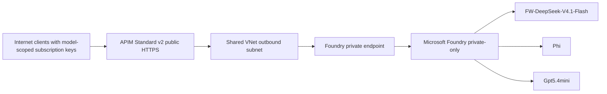

# Azure API Management Standard v2 with private Foundry

The active deployment is an isolated Sweden Central architecture:

No application, Azure Front Door, database, or storage account is deployed.
The gateway uses its
system-assigned managed identity and the account-scoped Foundry User role to
call model deployments over private networking without Foundry API keys.

## Active Terraform root

[terraform/apim-only](terraform/apim-only) has its own state and deploys only:

- API Management in the `StandardV2` pricing tier, one unit
- a private-only Microsoft Foundry `AIServices` account
- exactly three deployments: `Gpt5.4mini`, `Phi`, and `FW-DeepSeek-V4.1-Flash`
- three Foundry-linked backends and HTTPS model APIs, registered in AI Models,
  with three independently managed API-scoped subscriptions
- three additive Entra-protected model entrypoints on the same gateway, backed
  by one single-tenant API registration with separate per-model app roles
- three published, subscription-required products, each containing only its
  matching model API; new product subscriptions require administrator approval
  and are limited to one per developer per product
- one shared VNet with separate inbound and outbound subnets for each service
- Foundry and gateway private endpoints, private DNS, and supporting NSGs

APIM stays publicly accessible to internet clients. Its separate inbound
subnet additionally supports private clients. Foundry public access is disabled.
The Foundry trusted Azure services network exception is enabled; authentication
and RBAC permissions are still required.
Each APIM subscription is scoped to one model API. Its key cannot call the other
two APIs, and API policies validate and enforce the backend deployment rather
than trusting a client-supplied model override. Client subscription keys are
APIM credentials, not Foundry API keys; Foundry local authentication is disabled.
Entra callers use separate `/entra/<model-api-id>/openai/v1` entrypoints with
a gateway-audience bearer token and the matching model role. Existing key URLs
and keys remain unchanged; the same three backend models are reused.

The obsolete preview gateway has been deleted. Standard v2 uses the original
four /24 subnets; no subnet resizing is performed. The temporary migration
network is not part of the final configuration.

The AI Models and APIs portal pages manage the same underlying APIs. Terraform
associates the reserved `aimodel` tag with each model API so it appears in the
AI-focused view as well as the general APIs view. This metadata does not create
another Foundry deployment or replace subscription authorization.

The requested DeepSeek name maps to the GA Foundry catalog model
`DeepSeek-V4-Flash` version `2026-04-23`. No extra per-user model deployments or
application-specific cost policies are created.

See [terraform/apim-only/README.md](terraform/apim-only/README.md) for deployment,
the four-subnet layout, private networking, and secure access-key retrieval.

For administrator-led setup without Terraform, follow the
[Azure Portal manual runbook](manualsteps-apimv2-foundry.md). It covers the
ordered four-subnet, Foundry, Standard v2, managed-identity/RBAC, model API,
AI Models, subscription, product, and verification steps.

## Retained legacy definitions

The original [terraform](terraform) root still contains chat1, chat2, LiteLLM,
and MLflow definitions for later use. They are not part of the active isolated
state and were not deployed. The Front Door resource file and all Terraform
references to it were removed.

The standalone packages also remain unchanged:

- [standalone-litellm](standalone-litellm)
- [standalone-mlflow](standalone-mlflow)