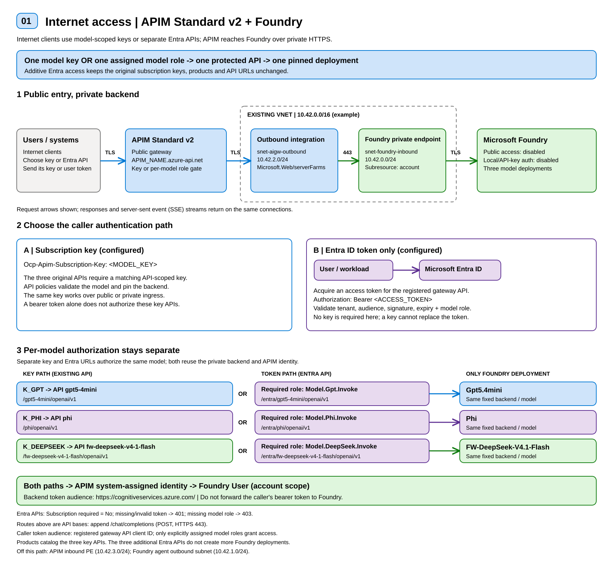
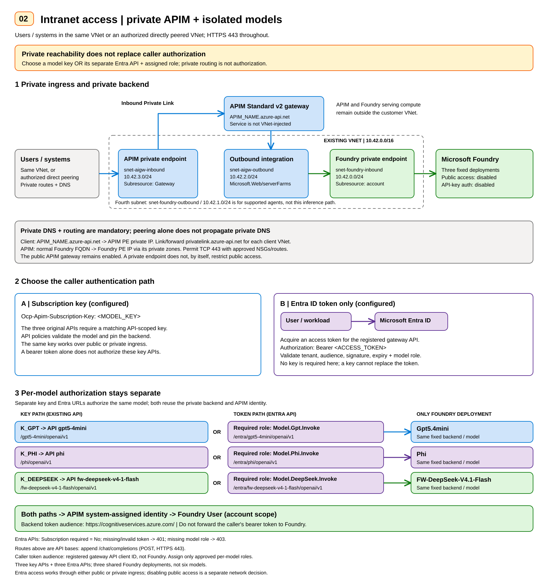

# Manual Azure Portal runbook: APIM Standard v2 and private Microsoft Foundry

**Standard v2 fallback only.** For the lower-cost AI Gateway pricing tier,
use the [AI Gateway portal runbook](manualsteps-apimv2-foundry.md). The two
tiers do not have interchangeable APIs, key scopes, or management portals.
When switching tiers, retain Foundry and shared networking and remove the
active gateway before reusing its dedicated outbound subnet. For a
Terraform-managed deployment, use the
[two-root switching procedure](terraform/apim-ai-gateway/README.md#switching-tiers)
instead of making untracked portal changes.

When returning from AI Gateway, treat sections 1-5 as inspection steps:
reuse Foundry, its three deployments, DNS, and all four subnets. Create only
the Standard gateway on the released outbound subnet. In section 13, reuse
the retained Entra registration, audience, roles, and assignments instead of
creating a second application. Its audience need not change when a new
gateway hostname is required.

This runbook creates the working pattern in this repository using the Azure
Portal and Microsoft Foundry portal, without running Terraform or Cloud Shell.
Portal labels can vary by release. Guidance checked on **17 October 2026**: the
tab, blade, and field names below were compared with the live Azure Portal
(Foundry and API Management creation wizards, Foundry **Networking**, APIM
**Network**, **Backends**, **Products**, **Subscriptions**, API **Settings** and
**Design**, **Access control (IAM)**, and Entra **App roles**) and with the
deployed reference configuration.

## Access diagrams

The SVGs distinguish caller authentication at APIM from APIM's managed-identity
authentication to Foundry. Names and CIDRs are reusable examples; key labels
such as `K_GPT` are placeholders, never actual subscription keys.

### Internet: model-scoped subscription keys or Entra ID

[Open the internet access SVG](docs/diagrams/apim-foundry-internet.svg).



### Intranet: private endpoint, VNet/peering, and authentication choices

[Open the intranet access SVG](docs/diagrams/apim-foundry-intranet.svg).



**Current configuration:** the three original model APIs require their matching
APIM subscription key. Three additional Entra-protected entrypoints use bearer
tokens and per-model roles, whether called through the public gateway or its
private endpoint. Private DNS must resolve the normal APIM hostname to its private IP
from each client network. Peering does not automatically propagate private DNS
links, and an inbound private endpoint does not disable the public gateway.

**Additive Entra-only access, deployed in the reference environment:** register a
gateway-facing API in Entra ID and define model-specific app roles
`Model.Gpt.Invoke`, `Model.Phi.Invoke`, and `Model.DeepSeek.Invoke`. Assign only
the intended model roles to authorized users or workloads. Add a separate
token-protected facade API per model on the same APIM gateway, with the same
fixed backend/model restrictions as its key-protected counterpart. Set
**Subscription required = No only on those facades**, and always apply
`validate-azure-ad-token` at API scope to validate tenant, audience, signature,
expiry, and the corresponding `roles` claim. Merely disabling the key requirement
would allow unauthorized access. Keep the existing public/key APIs unchanged.
The caller's access-token audience is the registered gateway API, not Foundry;
APIM replaces the caller credential with its own managed-identity token for the
Foundry hop. Section 13 gives the ordered administrator steps. The reference
deployment grants these roles only to the operating administrator; other users
and systems need explicit model-role assignments. This does not deploy another
gateway or model.

Editable diagram sources:
[internet](docs/diagrams/apim-foundry-internet.excalidraw) and
[intranet](docs/diagrams/apim-foundry-intranet.excalidraw).

## Target configuration and order

- Reuse an **existing, eligible VNet**; add four nonoverlapping `/24` subnets.
- Create one Microsoft Foundry resource with private inbound access and a
  dedicated subnet for supported outbound VNet injection.
- Deploy exactly three models: GPT mini, Phi, and DeepSeek Flash.
- Create one **API Management Standard v2** instance with outbound VNet
  integration and a separate inbound private endpoint. Keep its public gateway
  enabled, as in the working deployment.
- Enable APIM's **system-assigned managed identity** and grant it **Foundry
  User** on the Foundry account.
- Create three linked backends, three protected APIs visible in **AI Models**,
  three products, and three API-scoped subscriptions.
- Add one single-tenant Entra API registration and three separately authorized
  token-only entrypoints, reusing the same gateway and Foundry models.

**AI Models and APIs are two views of the same APIM APIs.** Do not duplicate
APIs merely to register AI Models metadata. Section 13 intentionally adds
three authentication-specific Entra entrypoints; neither those entrypoints
nor their AI Models registrations create another Foundry model deployment.

Follow the numbered sections in order:

1. Confirm permissions, names, region, and VNet.
2. Create subnets, delegations, and NSGs.
3. Create Foundry with the required authentication and outbound configuration.
4. Configure its private endpoint and DNS.
5. Deploy the three models.
6. Create APIM Standard v2 and configure both network directions.
7. Enable APIM identity and grant Foundry RBAC.
8. Create the three managed-identity backends.
9. Create/register the three APIs and their request schemas.
10. Apply the model-specific routing, validation, authentication, and CORS policies.
11. Create the three products.
12. Create the three API-scoped subscriptions.
13. Add Entra ID access: register the gateway API and model roles, assign them,
    and create the three token-protected entrypoints.
14. Verify real chat, authorization boundaries, and private connectivity.
15. Run the Python samples to test access from the Internet and from the
    intranet VNet.

Sections 16 and 17 are troubleshooting and references, not deployment steps.

Do not deploy an application service, LiteLLM, database, Storage account, Azure AI Search,
Cosmos DB, monitoring service, or a second gateway. Do not select the separate
**AI Gateway tier (preview)** or a unified all-model API in place of Standard v2.
Private endpoints, DNS zones/links, NSGs, and role assignments are necessary
supporting resources. The gateway-facing Entra API registration in section 13
is an identity configuration, not a hosted application service.

## 1. Administrator prerequisites and planning

### 1.1 Sign in and confirm permissions

1. Open [Azure Portal](https://portal.azure.com).
2. Use **Settings > Directories + subscriptions** to select the intended Entra
   tenant and subscription. For the reference environment, the tenant is
   `16b3c013-d300-468d-ac64-7eda0820b6d3`.
3. Confirm the administrator has:
   - Resource creation/update permissions in the target resource group.
   - Network Contributor or equivalent permissions on the existing VNet,
     including subnet creation, delegation, and subnet join.
   - Private DNS Zone Contributor or equivalent permissions on the DNS zones.
   - Role Based Access Control Administrator, User Access Administrator, Owner,
     or equivalent role-assignment permissions at the Foundry account scope.
   - Model deployment permissions, such as Cognitive Services Contributor or
     equivalent, and Foundry data-plane access for portal model tests.
   - Entra permissions to create/manage the gateway API registration and
     enterprise application, assign model app roles, and grant approved consent
     when completing section 13. These are not Azure subscription roles.
4. If required by organizational policy, activate these roles through PIM.
5. Under **Subscriptions > your subscription > Resource providers**, verify
   `Microsoft.Network`, `Microsoft.CognitiveServices`,
   `Microsoft.ApiManagement`, `Microsoft.Web`, and `Microsoft.App` are
   registered. Register only required providers; delegation to
   `Microsoft.Web/serverFarms` requires `Microsoft.Web`.

Do not grant APIM subscription-wide Contributor or Owner just to invoke models.
Provisioning permissions for the administrator are different from APIM's
runtime data-plane permissions.

### 1.2 Record deployment values

| Value | Administrator action / example |
|---|---|
| Tenant and subscription | Select the approved existing target. |
| Resource group | Reuse an approved group or create one in the chosen region. |
| Region | Use a region supporting Standard v2, the three models, and the requested Foundry networking features. Sweden Central is the working reference. |
| Existing VNet | Select a VNet in the **same region and subscription as APIM**. Review its DNS servers, routes, peerings, and policies. |
| Foundry resource name | A globally unique name, referred to below as `FOUNDRY_NAME`. |
| APIM resource name | A globally unique name, referred to below as `APIM_NAME`. |
| Administrator/client CIDRs | Existing private client ranges allowed to reach private endpoints. |
| Address ranges | Four unused `/24` ranges inside the existing VNet address space. |

An arbitrary existing VNet is not automatically eligible: APIM outbound
integration requires the same subscription/region, a dedicated subnet, an NSG,
and the correct delegation. If the chosen VNet lacks four suitable ranges,
stop and obtain an approved address plan. Do not resize, replace, or overlap
existing subnets.

Have existing VPN, ExpressRoute, peering/routing, and DNS connectivity available
if the administrator needs to use Foundry's private data-plane portal features.
The public Azure Portal loading successfully does not prove the browser can
reach a private Foundry endpoint. This runbook does not create a VM or VPN.

## 2. Create four subnets in the existing VNet

The following prefixes are **examples only**, valid when those ranges are
available inside the selected VNet. Replace them consistently if necessary.

| Subnet | Example prefix | Purpose | Delegation |
|---|---|---|---|
| `snet-foundry-inbound` | `10.42.0.0/24` | Foundry private endpoint NICs | None |
| `snet-foundry-outbound` | `10.42.1.0/24` | Supported Foundry agent/evaluation outbound injection | `Microsoft.App/environments` |
| `snet-aigw-outbound` | `10.42.2.0/24` | APIM Standard v2 outbound VNet integration | `Microsoft.Web/serverFarms` |
| `snet-aigw-inbound` | `10.42.3.0/24` | APIM inbound private endpoint | None |

1. Open **Virtual networks > existing VNet > Settings > Subnets > + Subnet**.
2. Create each subnet with its approved prefix.
3. For each outbound subnet, select the delegation in the table.
4. Leave both private-endpoint subnets **undelegated**. Do not place private
   endpoints in either dedicated outbound subnet.
5. Keep `snet-aigw-outbound` exclusive to this APIM instance; do not share it
   with App Service or another APIM service despite its delegation name.

The `/24` layout matches the reference deployment. Microsoft documents `/27`
as the minimum for APIM integration and for the Foundry injection flow cited
below; using `/24` here does not place either service's entire compute fleet
inside that subnet.

### 2.1 Configure NSGs

Use **Network security groups > Create**, then associate each NSG under
**NSG > Settings > Subnets > Associate**.

| NSG / subnet | Direction and suggested priority | Allow rule |
|---|---|---|
| Foundry inbound NSG / `snet-foundry-inbound` | Inbound, 100 | TCP 443 from the APIM outbound subnet and the Foundry outbound subnet to this subnet. The reference allows only these two sources; add approved administrator/client CIDRs only if people must reach the private Foundry endpoint directly. |
| Foundry inbound NSG | Inbound, 4000 | Deny other inbound traffic after the intended allow rules. |
| APIM inbound NSG / `snet-aigw-inbound` | Inbound, 100 | TCP 443 from approved private client ranges; the reference allows the `VirtualNetwork` service tag (which includes directly peered VNets). |
| APIM inbound NSG | Inbound, 4000 | Deny other inbound traffic after the intended allow rules. |
| APIM outbound NSG / `snet-aigw-outbound` | Outbound, 100 | TCP 443 to `Storage`. The APIM creation wizard requires the subnet's NSG to allow outbound access to Azure Storage. |
| APIM outbound NSG | Outbound, 110 | TCP 443 to `AzureKeyVault`, an APIM dependency. |
| APIM outbound NSG | Outbound, 120 | TCP 443 to the Foundry inbound subnet. |

Use source port `*` for these connection rules. On the two private-endpoint
subnets, set the subnet's private endpoint network policy to include
**Network security groups** so the NSGs enforce these rules.

`snet-foundry-outbound` needs no custom rules for this model-inference-only
pattern; the reference subnet is attached to an automatically generated NSG that
has no custom rules.

Keep required DNS access to the existing resolver. If existing NSGs, UDRs, or
firewalls restrict egress, have the network administrator allow the documented
service dependencies and return path before continuing. Do not blindly add
a deny-all egress rule or remove existing routes.

Inbound rules on the APIM **outbound integration subnet** do not protect the
public gateway. The separate private-endpoint subnet is the private inbound
path. Foundry outbound subnet rules must follow the supported workload's
requirements if agents/evaluations are enabled later.

## 3. Create the Microsoft Foundry resource

### 3.1 Choose the creation path

Create the account with **one** of the following paths, never both.

| Path | Choose it when | Limitation |
|---|---|---|
| **A. Foundry creation wizard** (3.2) | Your organization already enforces disabled key (local) authentication through Azure Policy, or an approved administrator will disable it after creation. | The wizard has **no local-authentication setting**, so a new account has API keys enabled unless policy changes that. |
| **B. Custom template in the portal** (3.3) | You want the exact reference account in one step: `disableLocalAuth = true`, the trusted-services exception, and agent network injection, with no extra dependency resources. | Creates the account only; create the project afterwards (3.4). |

### 3.2 Path A: Foundry creation wizard

The portal's **Create a Foundry resource** wizard has these tabs: **Basics,
Storage, Inbound Networking, Outbound Networking, Identity, Encryption, Tags,
Review + create**.

1. In Azure Portal, select **Create a resource**, search for **Foundry**, and
   open **Create a Foundry resource**.
2. On **Basics**, select the approved subscription and resource group, enter
   `FOUNDRY_NAME`, and select the region. Use a **Foundry / AIServices**
   resource, not a legacy hub with additional dependent services. Accept the
   **Default project name**: the wizard creates one default project with the
   resource (the reference project is `FOUNDRY_NAME-project`).
3. On **Storage**, leave **Key Vault**, **Application Insights**, the **Agent
   service** resources (Cosmos DB, AI Search, Storage Account), and the Speech
   and Language **Storage Account** unselected. By default the data stays in the
   Foundry resource.
4. On **Inbound Networking**, select **Disabled, no networks can access this
   resource**. Under **Private endpoint**, select **Add Private Endpoint**,
   choose the target sub-resource **account** and `snet-foundry-inbound`, and
   enable private DNS integration (the table lists three private DNS zones).
   Section 4 explains and verifies this endpoint; you may also add it after
   creation.
5. On **Outbound Networking**, under **Network isolation mode for Agent**, select
   **Custom VNet**, then select the existing **Virtual network name** and
   **Virtual network subnet** `snet-foundry-outbound`. The wizard lists only
   subnets delegated to `Microsoft.App/environments`, which is why section 2
   delegates this subnet. It notes that **Managed virtual network (preview)**
   cannot be enabled in the portal; the reference keeps it disabled.
6. On **Identity**, keep **System assigned**. The wizard also grants the
   creating user the **Foundry User** role on the resource.
7. On **Encryption**, keep Microsoft-managed keys. On **Tags**, apply the
   organization's required tags. Select **Review + create > Create**.

**Do not select Agent service Cosmos DB, AI Search, or Storage resources for this
model-inference-only scenario.** The reference deployment has none of them.

After creation, open **Keys and Endpoint**. The required state is *API key
authentication is disabled by your resource owner* (`disableLocalAuth = true`).
If keys are still enabled, the portal wizard cannot change that: obtain the
approved policy or administrator action, or create a **new** account with path B.
Do not enable or distribute Foundry keys.

### 3.3 Path B: custom template in the portal (exact account settings)

This path still uses Azure Portal, not a command line. It creates only the
Foundry account, with no project; the private endpoint and models come in later
sections. Use it for a **new** account, not as an unreviewed overwrite of an
existing account.

1. Search Azure Portal for **Deploy a custom template**.
2. Select **Build your own template in the editor**.
3. Replace the editor contents with the template below and select **Save**.
4. Select the approved subscription and resource group.
5. Enter the new Foundry name and region. For `foundryOutboundSubnetId`, paste
   the **full resource ID** of the existing `snet-foundry-outbound` subnet,
   copied from the subnet's properties.
6. Select **Review + create > Create**.

```json
{
  "$schema": "https://schema.management.azure.com/schemas/2019-04-01/deploymentTemplate.json#",
  "contentVersion": "1.0.0.0",
  "parameters": {
    "foundryName": { "type": "string" },
    "location": { "type": "string" },
    "foundryOutboundSubnetId": { "type": "string" }
  },
  "resources": [
    {
      "type": "Microsoft.CognitiveServices/accounts",
      "apiVersion": "2025-04-01-preview",
      "name": "[parameters('foundryName')]",
      "location": "[parameters('location')]",
      "kind": "AIServices",
      "sku": { "name": "S0" },
      "identity": { "type": "SystemAssigned" },
      "properties": {
        "allowProjectManagement": true,
        "customSubDomainName": "[parameters('foundryName')]",
        "disableLocalAuth": true,
        "publicNetworkAccess": "Disabled",
        "networkAcls": {
          "defaultAction": "Deny",
          "bypass": "AzureServices",
          "ipRules": [],
          "virtualNetworkRules": []
        },
        "networkInjections": [
          {
            "scenario": "agent",
            "subnetArmId": "[parameters('foundryOutboundSubnetId')]",
            "useMicrosoftManagedNetwork": false
          }
        ]
      }
    }
  ]
}
```

The template mirrors the deployed account's approved trusted Azure services
exception, `bypass = AzureServices`. This is not anonymous access and does not
grant RBAC. If organizational policy prohibits that exception, obtain an
approved configuration rather than enabling public access or API keys.

### 3.4 Confirm scope, authentication, and project

1. Open the Foundry resource, then **Overview > JSON View**. Confirm
   `kind = AIServices`, public network access is `Disabled`,
   `disableLocalAuth` is `true`, and the agent network injection references the
   correct outbound subnet with `useMicrosoftManagedNetwork = false`.
2. Open **Resource Management > Networking** and confirm:
   - **Firewalls and virtual networks**: **Disabled** is selected. The reference
     also keeps **Allow Azure services on the trusted services list to access this
     cognitive services account** checked.
   - **Network Injection**: **Delegated subnet ID** is `snet-foundry-outbound` and
     **Managed virtual network** is **Disabled**. This tab is read-only after
     deployment; the portal states that the delegated subnet cannot be changed
     later.
3. Open **Resource Management > Keys and Endpoint** and confirm the message *API
   key authentication is disabled by your resource owner*. If organizational
   policy already disables API keys, leave that enforcement in place. Do not
   request an exemption or retrieve a Foundry key.
4. Open **Resource Management > Projects**. Path A already created the default
   project. After path B, select **New** and create **one** project (the
   reference name is `FOUNDRY_NAME-project`), because the Foundry portal needs a
   project to deploy models. Do not create a resource or project per model, or
   enable agent dependencies just to deploy models.

**Important:** Foundry's `agent` network injection applies to supported
agent/evaluation workloads. It does not move GPT/Phi/DeepSeek serving compute
into your subnet or force all model-provider egress through it. APIM reaches
the models through Foundry's **inbound private endpoint**.

## 4. Configure Foundry private endpoint and private DNS

Skip endpoint creation if it was completed during section 3.2; inspect the
existing connection instead of creating a duplicate.

1. Open **Foundry resource > Resource Management > Networking**, select the
   **Private endpoint connections** tab, and select **+ Private endpoint**. The
   tab lists each connection with its state; the reference shows **Approved**.
2. Use the existing VNet's region and the approved resource group.
3. Select the Foundry **account** as the target resource and **account** as
   the target subresource.
4. Select the existing VNet and `snet-foundry-inbound`.
5. Enable private DNS integration. Reuse existing authoritative zones when
   present instead of creating duplicate zones for the same namespace.
6. Ensure the endpoint's private DNS zone group covers:
   - `privatelink.services.ai.azure.com`
   - `privatelink.openai.azure.com`
   - `privatelink.cognitiveservices.azure.com`
7. Under **Private DNS zones > each zone > Virtual network links**, link the
   existing VNet. Keep automatic VM registration disabled for these zones.
8. Under **Private endpoint > DNS configuration**, verify the generated
   records against the endpoint's IP configurations. Do not assume all
   Foundry endpoint hostnames use a single identical private IP.
9. Confirm the connection is **Approved** and provisioning is **Succeeded**.

If the VNet uses custom DNS, configure the existing DNS infrastructure to
resolve these private-link zones. A VNet link alone does not override a custom
DNS server that never forwards those queries.

Continue using normal service hostnames such as
`FOUNDRY_NAME.services.ai.azure.com` in backend URLs. Private DNS selects the
private IP; do not replace HTTPS hostnames with IP addresses or `privatelink`
hostnames.

**Checkpoint:** from an existing network-connected administration environment,
the Foundry hostnames resolve to their private endpoint IPs and TCP 443 is
reachable. A public workstation cannot directly use a private Foundry
playground merely because the portal is authenticated.

## 5. Deploy exactly three models in Foundry

1. Open the Foundry resource in Azure Portal and select **Go to Foundry portal**
   (the Azure portal blade has no model-deployment page), or open
   [Microsoft Foundry](https://ai.azure.com) and select the account's project
   (the reference project is `FOUNDRY_NAME-project`).
2. Open **Models + endpoints**, select **+ Deploy model > Deploy base model**
   (or start from the **Model catalog**), depending on the portal experience.
3. Search for the exact catalog model, select **Deploy**, and use the values
   below for **Deployment name** and **Deployment type**. Repeat once for each
   model.

| Catalog model | Version in the working reference | Deployment name | Deployment type | Reference capacity |
|---|---|---|---|---:|
| `gpt-5.4-mini` | `2026-03-17` | `Gpt5.4mini` | Global Standard | 1 |
| `Phi-4` | `7` | `Phi` | Global Standard | 1 |
| `DeepSeek-V4-Flash` | `2026-04-23` | `FW-DeepSeek-V4.1-Flash` | Global Standard | 250 |

4. Confirm the selected version, deployment type, regional availability,
   quota, and any required model terms. Do not choose managed compute or
   create a standalone compute endpoint instead of a deployment in this account.
5. Where available, set the version update policy to no automatic upgrade (ARM
   value `NoAutoUpgrade`) to reproduce the pinned versions. Review
   provider-specific lifecycle rules if the option differs.
6. Choose an explicitly approved capacity. Portal controls may express it as
   TPM rather than the raw capacity number; inspect the displayed limits.
7. Wait for all three deployments to report **Succeeded**.
8. Record each deployment name exactly, including case. The model catalog
   name and deployment name are not interchangeable in the API configuration.

These versions/capacities are a known working reference, not a promise of
availability in every region or subscription. If any exact model is
unavailable, stop for approval of a replacement or region; do not silently
substitute another model or add a fourth deployment.

**Throughput warning:** in the reference environment, capacity-1 GPT mini and
Phi each advertise **1 request/minute and 1,000 tokens/minute**. DeepSeek's
capacity 250 advertises 250 requests/minute and 250,000 tokens/minute. Separate
APIM keys do not create additional Foundry throughput.

## 6. Create APIM Standard v2 and connect its two network directions

The **Create API Management service** wizard has these tabs: **Basics, Add-ins,
Networking, Managed identity, Tags, Review + install**.

1. In Azure Portal, search **API Management services > Create**.
2. On **Basics**, select the approved subscription, resource group, and region,
   then enter `APIM_NAME` (**Resource name**), **Organization name**, and
   **Administrator email**.
3. Set **Pricing tier** to **Standard v2** and **Unit(s)** to **1**. Leave
   **Enable zone redundancy** cleared unless it is separately approved.
4. On **Add-ins**, leave **API Center**, **Log Analytics**, **Defender**, and
   **Application insights** cleared. The reference deploys none of them.
5. On **Networking**, select **Private link (inbound only)** and **Virtual
   network integration (outbound only)**. Do **not** select **Virtual network
   injection**: the portal offers it only for the Premium and Premium v2 tiers.
6. Under **Virtual network integration**, select the existing **Virtual network**
   and the **Subnets** value `snet-aigw-outbound`. The portal lists the
   requirements: same region and subscription as the gateway; a subnet that is
   not shared with another resource (**/24 recommended**); delegation to
   `Microsoft.Web/serverFarms` (the portal updates a missing delegation
   automatically); no other delegation; and an associated NSG that allows
   outbound access to Azure Storage.
7. Under **Private link (inbound only) > Private endpoints**, select
   **+ Create new** and add the inbound endpoint:
   - Target subresource: **Gateway**.
   - VNet/subnet: existing VNet / `snet-aigw-inbound`.
   - Private DNS integration: `privatelink.azure-api.net`.
8. On **Managed identity**, you may set **System assigned managed identity >
   Status** now; section 7.1 covers enabling it afterwards.
9. On **Tags**, apply the organization's required tags. Keep the public gateway
   enabled (the default): the private endpoint is an additional access path, not
   a requirement to make all clients private.
10. Select **Review + install**, then **Create**. Wait for **Succeeded**.

For an existing Standard v2 instance, expand **Deployment + infrastructure** in
the left menu and open **Network**. The blade shows **Inbound** (**Public network
access**, **Private endpoints**, **Protocols + ciphers**) and **Outbound**
(**Virtual network integration**); select **Edit** to change them. The
reference shows *Network configuration: Inbound public access, outbound private
network*, **Public network access = Enabled**, and *1 private endpoint(s)*.

Verify `privatelink.azure-api.net` is linked to the existing VNet, the private
endpoint is **Approved**, and the public gateway is
`https://APIM_NAME.azure-api.net`.

Do not select classic-tier Internal/External injection instructions or Premium
v2 full injection in place of **Standard v2 outbound integration**.

## 7. Enable APIM system-assigned identity and grant Foundry RBAC

### 7.1 Create the APIM identity

1. Open **APIM > Security > Managed identities** (expand **Security** in the
   left menu if it is collapsed); some portal versions label the blade
   **Identity**.
2. Under **System assigned**, set **Status = On** and select **Save**.
3. Record its **Object (principal) ID**.

Azure creates the corresponding Entra service principal automatically. Do not
create a user-assigned identity, application registration, client secret, or
separate Entra user for this connection.

### 7.2 Assign the runtime role on Foundry

1. Open the **Foundry account resource**, not just its project.
2. Select **Access control (IAM) > Add > Add role assignment**. The wizard has
   the tabs **Role, Members, Conditions, Review + assign**.
3. On **Role**, search for **Foundry User** and select it (a built-in role in
   the *AI + Machine Learning* category).
   - Role definition ID: `53ca6127-db72-4b80-b1b0-d745d6d5456d`.
   - Do not pick the similarly named **Foundry Project Runtime User**, **Azure AI
     Developer**, **Foundry Project Manager**, or **Foundry Account Owner**.
4. On **Members**, set **Assign access to** to **Managed identity**, then select
   **+ Select members**.
5. In the pane, select the correct subscription, set **Managed identity** to
   **API Management service**, and select `APIM_NAME`. Verify the principal ID
   matches section 7.1.
6. Select **Review + assign**.
7. Check **Role assignments** to confirm the scope is the **Foundry account**,
   not the entire subscription and not APIM itself.
8. Allow time for RBAC propagation before testing.

Use Foundry User for the mixed GPT/Phi/DeepSeek account in this runbook, as
verified in the working deployment. Do not assume an OpenAI-only role covers
every non-OpenAI model.

The token audience is **`https://cognitiveservices.azure.com/`**. It is not
the Foundry account URL, the APIM URL, or an Azure management token audience.

## 8. Create three Foundry-linked managed-identity backends in APIM

For each row, open **APIM > APIs > Backends** and select **Create new backend**
(the Backends blade has the tabs **Backends** and **Load balancer**):

| Backend name | Title | Runtime URL |
|---|---|---|
| `gpt5-4mini` | `Gpt5.4mini` | `https://FOUNDRY_NAME.services.ai.azure.com/openai/v1` |
| `phi` | `Phi` | `https://FOUNDRY_NAME.services.ai.azure.com/models` |
| `fw-deepseek-v4-1-flash` | `FW-DeepSeek-V4.1-Flash` | `https://FOUNDRY_NAME.services.ai.azure.com/models` |

1. Enter **Name** from the table. In **Description**, use text such as
   `Foundry gpt-5.4-mini deployment Gpt5.4mini.` (the title column is the
   deployment name).
2. Under **Backend hosting type**, select **Azure resource** (the other options
   are Custom URL and Service Fabric). In the **Azure resource** search box,
   select the Foundry account. Check **Runtime URL** against the table; it is not
   the Foundry project endpoint.
3. Leave **LLM configuration** (API format, Model name), **Add to load-balanced
   pool**, and **Circuit breaker rule** empty or at their defaults. The reference
   backends show **Circuit breaker = Disabled**.
4. Under **Authorization credentials**, open the **Managed Identity** tab and
   select **Enable**.
5. Set **Client identity** to **System assigned identity**.
6. In **Resource ID**, enter `https://cognitiveservices.azure.com/`.
7. Expand **Advanced** and leave **Validate certificate chain** and **Validate
   certificate name** selected.
8. Do not add a Foundry `api-key`, header, query parameter, certificate, stored
   secret, pool, or additional service.
9. Select **Create** and repeat for the other two. The list should show three
   backends of Type **Azure resource** with the runtime URLs above.

**Two different identifiers:** the backend's Azure resource association is the
Foundry ARM resource (in its ARM representation, `resourceId` is
`https://management.azure.com` followed by the Foundry account's full resource
ID). The **Managed Identity > Resource ID** field is the **token audience**. Do
not paste the Foundry ARM ID into the token audience field.

If the **Azure resource** search does not expose Foundry, the supported **APIs >
+ Add API > Microsoft Foundry** importer (under *Create an AI API*) can create
the Foundry association and managed identity backend. Use that as an
**alternative initial API creation path**, then edit the same API and backend to
match sections 8-10. The importer also adds a backend named
`FOUNDRY_NAME-ai-endpoint` (runtime URL = the account root) and generic
operation tags such as *Chat Completions* and *Responses*; none of them is part
of this pattern. Do not leave a duplicate imported all-model API, reuse its
backend when appropriate, and do not distribute keys until its
routes/schema/policy are restricted to one model.

In the ARM representation, backend `protocol = http` is correct even when the
runtime URL is HTTPS. It does not mean the upstream request uses plaintext.

## 9. Create three APIs and register those same APIs in AI Models

### 9.1 API settings and OpenAPI import

Use **APIM > APIs > APIs > + Add API**. Under *Create from definition*, select
**OpenAPI** (the gallery also offers *Create an AI API > Microsoft Foundry*,
described in section 8). In **Create from OpenAPI specification**, set **View
options** to **Full**, select the JSON example below (saved as a local file of
at most 4 MiB) with **Select a file**, and complete the form once per model
after making the replacements in the first table.

If section 8's Foundry importer already created an API, **edit that existing
API's OpenAPI definition instead**. Do not select Add API a second time for
the same model. Under its **Design > All operations > Frontend**, use the
OpenAPI specification/code editor to update the contract.

Import form fields:

| Field | GPT mini | Phi | DeepSeek Flash |
|---|---|---|---|
| Name (API ID) | `gpt5-4mini` | `phi` | `fw-deepseek-v4-1-flash` |
| Display name | `Gpt5.4mini` | `Phi` | `FW-DeepSeek-V4.1-Flash` |
| API URL suffix | `gpt5-4mini/openai/v1` | `phi/openai/v1` | `fw-deepseek-v4-1-flash/openai/v1` |
| URL scheme | HTTPS | HTTPS | HTTPS |

Leave **Tags** and **Products** empty for now (section 9.2 adds the `aimodel`
tag after the policy exists, and section 11 creates the products), and leave
**Version this API?** cleared. Select **Create**.

The import takes the upstream address from the file's `servers` entry. After
import, open the API's **Settings** tab and set or confirm the following, then
select **Save**:

| Settings field | GPT mini | Phi | DeepSeek Flash |
|---|---|---|---|
| Web service URL | GPT runtime URL in section 8 | Phi runtime URL in section 8 | DeepSeek runtime URL in section 8 |
| URL scheme | HTTPS | HTTPS | HTTPS |
| Subscription required | Selected | Selected | Selected |
| Header name | `Ocp-Apim-Subscription-Key` | same | same |
| Query parameter name | `subscription-key` | same | same |

The following is the GPT contract. For Phi or DeepSeek, replace **every**
`Gpt5.4mini` occurrence with that model's exact deployment name. Change only
the server URL to its backend URL from section 8; keep each public API suffix
from the import form table.

```json
{
  "openapi": "3.0.1",
  "info": { "title": "Gpt5.4mini", "version": "1.0" },
  "servers": [
    { "url": "https://FOUNDRY_NAME.services.ai.azure.com/openai/v1" }
  ],
  "paths": {
    "/chat/completions": {
      "post": {
        "operationId": "chat-completions",
        "summary": "Chat with Gpt5.4mini",
        "requestBody": {
          "required": true,
          "content": {
            "application/json": {
              "schema": { "$ref": "#/components/schemas/ChatCompletionRequest" }
            }
          }
        },
        "responses": {
          "200": { "description": "Model completion or server-sent event stream." }
        }
      }
    },
    "/deployments/Gpt5.4mini/chat/completions": {
      "post": {
        "operationId": "deployment-chat-completions",
        "summary": "Portal chat with Gpt5.4mini",
        "requestBody": {
          "required": true,
          "content": {
            "application/json": {
              "schema": { "$ref": "#/components/schemas/ChatCompletionRequest" }
            }
          }
        },
        "responses": {
          "200": { "description": "Model completion or server-sent event stream." }
        }
      }
    }
  },
  "components": {
    "schemas": {
      "ChatCompletionRequest": {
        "type": "object",
        "required": ["model", "messages"],
        "additionalProperties": true,
        "properties": {
          "model": { "type": "string", "enum": ["Gpt5.4mini"] },
          "messages": {
            "type": "array",
            "minItems": 1,
            "items": { "type": "object", "additionalProperties": true }
          }
        }
      }
    }
  }
}
```

For each API, confirm under **Settings**:

- **Subscription required** is selected.
- **Header name** is `Ocp-Apim-Subscription-Key`.
- **Query parameter name** is `subscription-key`.
- Only its two POST operations exist: the canonical route and its own exact
  deployment-qualified route. Remove broader imported operations before use.
- There is no wildcard `{deployment}` route, `/responses` route, or explicit
  OPTIONS operation in this chat-only contract.
- The request schema's `model` enum contains only its permitted deployment.

### 9.2 Register the API in the AI Models view

1. Open the API's **Settings** tab, add the API-level tag **`aimodel`** in the
   **Tags** field, then select **Save**. Portal releases may expose this as
   **Manage tags**.
2. Apply it to all three existing model APIs.
3. Open **AI Gateway > AI Models** and refresh.
4. Confirm there are exactly the three model entries and that opening an entry
   refers to its existing API ID.

This reserved API tag is the mechanism verified in this repository. It is
**not** an Azure resource-group/resource tag, and adding only OpenAPI operation
tags is not equivalent. If the portal's Foundry import path already applied
it, keep that registration rather than importing again.

The **APIs > Microsoft Foundry** importer and **AI Gateway > AI Models** are
not separate model-hosting services. Do not use the preview AI Gateway SKU's
model-provider setup wizard for this Standard v2 procedure.

## 10. Apply the per-model API policies

1. Open **APIM > APIs > APIs > selected API > Design > All operations**. The
   Design tab has **Frontend**, **Inbound processing**, **Backend**, and
   **Outbound processing** sections for the selected scope.
2. Under **Inbound processing**, open the **Policies** code editor (the `</>`
   icon).
3. Apply the complete policy below for GPT. For the other APIs, replace:

| API | Replace `Gpt5.4mini` with | Replace backend ID `gpt5-4mini` with | Extra backend query parameter |
|---|---|---|---|
| GPT mini | No change | No change | None |
| Phi | `Phi` | `phi` | `api-version=2024-05-01-preview` |
| DeepSeek Flash | `FW-DeepSeek-V4.1-Flash` | `fw-deepseek-v4-1-flash` | `api-version=2024-05-01-preview` |

```xml
<policies>
  <inbound>
    <cors allow-credentials="false">
      <allowed-origins>
        <origin>https://ms.portal.azure.com</origin>
        <origin>https://portal.azure.com</origin>
        <origin>@{
          var origin = context.Request.Headers.GetValueOrDefault("Origin", "");
          return System.Text.RegularExpressions.Regex.IsMatch(origin, @"\Ahttps://sandbox-[0-9]+\.reactblade(-ms)?\.portal\.azure\.net\z")
            ? origin : "https://ms.portal.azure.com";
        }</origin>
      </allowed-origins>
      <allowed-methods>
        <method>POST</method>
      </allowed-methods>
      <allowed-headers>
        <header>*</header>
      </allowed-headers>
    </cors>
    <base />
    <validate-content unspecified-content-type-action="prevent" max-size="4194304" size-exceeded-action="prevent" errors-variable-name="request-body-errors">
      <content type="application/json" validate-as="json" action="prevent" />
    </validate-content>
    <set-body>@{
      var body = context.Request.Body.As&lt;JObject&gt;(preserveContent: true);
      body["model"] = "Gpt5.4mini";
      return body.ToString(Newtonsoft.Json.Formatting.None);
    }</set-body>
    <set-header name="Ocp-Apim-Subscription-Key" exists-action="delete" />
    <set-header name="api-key" exists-action="delete" />
    <set-header name="x-ms-model-mesh-model-name" exists-action="delete" />
    <set-header name="azureml-model-deployment" exists-action="delete" />
    <rewrite-uri template="/chat/completions" copy-unmatched-params="false" />
    <set-backend-service id="apim-generated-policy" backend-id="gpt5-4mini" />
    <authentication-managed-identity resource="https://cognitiveservices.azure.com/" ignore-error="false" />
  </inbound>
  <backend>
    <forward-request buffer-response="false" />
  </backend>
  <outbound>
    <base />
  </outbound>
  <on-error>
    <base />
  </on-error>
</policies>
```

For **Phi and DeepSeek only**, insert the following immediately after
`rewrite-uri` and before `set-backend-service`:

```xml
<set-query-parameter name="api-version" exists-action="override">
  <value>2024-05-01-preview</value>
</set-query-parameter>
```

4. Save each API policy. Inspect inherited policies on an existing service for
   conflicts; do not overwrite unrelated service-wide governance.
5. Confirm both operations inherit the API-level policy and have no overrides
   that bypass it.

### Why these settings matter

- CORS runs **first at API scope**, before inherited policies. A header-key
  preflight cannot rely on identifying a product. An explicit OPTIONS operation
  would bypass APIM's normal CORS preflight handling.
- The real AI Models console can run in
  `https://sandbox-3.reactblade-ms.portal.azure.net`. Allowing only the outer
  portal address caused the previously observed browser chat failure.
- The expression permits only the complete HTTPS numeric sandbox hostnames
  under the two specified portal namespaces. It does not allow arbitrary
  origins, extra domain suffixes, HTTP, or nondefault ports. Browser credential
  sharing remains disabled; subscription authentication is still required.
- Schema validation rejects a mismatched model before the policy pins the
  backend deployment. A client cannot use one model's API to select another.
- Client routing headers, client backend keys, and unmatched query parameters
  are removed. The query subscription key is validated by APIM before the
  rewritten upstream request drops it.
- Managed identity supplies the upstream bearer token; clients supply APIM
  subscription keys, not Foundry keys.
- `buffer-response="false"` preserves streaming.
- Keep the literal backend reference and `apim-generated-policy` identifier.
  A blank Backend label in AI Models Overview does not by itself mean routing
  is broken; actual backend settings and successful chat are the acceptance
  criteria. Do not invent an API `backendId` property to repair that label.

Do not configure security only at product scope: **API-scoped subscriptions
do not execute product-level policies**.

## 11. Create three separate model products

For each row, open **APIM > APIs > Products** and select **Add** (the pane is
titled **Add product**):

| Product ID | Display name | Only API in the product |
|---|---|---|
| `gpt5-4mini` | `Gpt5.4mini` | `gpt5-4mini` |
| `phi` | `Phi` | `phi` |
| `fw-deepseek-v4-1-flash` | `FW-DeepSeek-V4.1-Flash` | `fw-deepseek-v4-1-flash` |

1. Enter **Display name** and **Id** from the table, and a **Description** such
   as `Access only to the Gpt5.4mini Foundry deployment through its dedicated
   API.`
2. Select **Requires subscription**.
3. Select **Requires approval**.
4. Set **Subscription count limit** to **1**. Approval requires a positive limit
   in this configuration; do not leave it blank or zero.
5. Under **APIs**, add only the matching API (the API's own **Settings >
   Products** field is an equivalent way to associate it).
6. Select **Published** (the policy from section 10 must already be in place;
   if you skipped ahead, leave it cleared and publish later), then select
   **Create**.
7. Open the product's **Access control** and allow the existing **Developers**
   group. Keep administrator access and do not grant anonymous **Guests**
   visibility. The reference list shows *Administrators, Developers*.
8. Check that the list shows each product's **State** as **Published** and that
   each product's API list contains exactly one matching API.

The subscription count limit is per user per product; it is not RPM, a token
budget, or a global limit of one customer. Publishing a product does not
convert an API-scoped subscription into a product-scoped subscription.

Do not add the model APIs to an open product or a common product containing
all three models. Review any default Starter/Unlimited products on a new APIM
instance, but do not delete unrelated resources on an existing service.

## 12. Create three API-scoped subscriptions

Open **APIM > APIs > Subscriptions** and select **Add subscription** (the pane is
titled **New subscription**), once per model:

| Name (subscription ID) | Display name | Scope | Selected API |
|---|---|---|---|
| `gpt5-4mini` | `Gpt5.4mini access` | API | `gpt5-4mini` |
| `phi` | `Phi access` | API | `phi` |
| `fw-deepseek-v4-1-flash` | `FW-DeepSeek-V4.1-Flash access` | API | `fw-deepseek-v4-1-flash` |

1. Enter **Name** and **Display name** from the table. Leave **Allow tracing**
   cleared for routine use.
2. For the scope, choose **API**, not **All APIs** or **Product**, then select
   the current API in the **API** list, not a revision-qualified `;rev=1`
   resource.
3. Optionally select the intended **User**; leaving it empty makes it a
   standalone administrator-managed subscription.
4. Select **Create**. In the list, the **Scope** column must read
   *API: <display name>* and **State** must be **Active**.
5. Securely distribute each subscription's own primary/secondary keys only to
   that model's authorized consumers. The list masks keys by default.
6. Keep keys out of this document, screenshots, source control, and shared logs.

The three subscriptions intentionally use **API scope**, matching the deployed
pattern. Products provide separate catalog/onboarding boundaries. Developer
requests for new product-scoped subscriptions follow product approval; do not
create three additional product subscriptions unless that is explicitly desired.

Do not change an existing subscription's scope merely to attach it to a
product. Such a migration can replace the subscription or rotate keys when
managed by infrastructure tooling.

## 13. Add Entra ID access alongside the existing subscription APIs

This additive design keeps the existing three key-required APIs, products, and
subscription keys unchanged. It adds three token-only authentication entrypoints
on the **same** gateway, reusing the same backends and Foundry deployments.

### 13.1 Register the gateway API and model roles

1. In **Microsoft Entra ID > App registrations > New registration**, use
   `APIM_NAME-model-access` and **Accounts in this organizational directory only**.
   No redirect URI is required for this resource/API registration.
2. Record its **Application (client) ID**, **Directory (tenant) ID**, and app
   object ID. Do not create a client secret or enable implicit/public-client
   sign-in on this resource API. The app's **Overview** should show *My
   organization only*, no client credentials, and no redirect URIs.
3. Under **Expose an API**, set the Application ID URI to
   `api://TENANT_ID/APIM_NAME`. Add an enabled **Admin-consent** delegated scope
   `access_as_user`; describe that separate model roles are still required.
4. In **Manifest**, set **api.requestedAccessTokenVersion = 2**. The expected
   v2 access-token audience is the application/client ID.
5. Under **App roles > Create app role**, create these enabled roles, setting
   **Allowed member types** to **Both (Users/Groups + Applications)**. The
   reference **Display name** is `Invoke <deployment>` and its **Description** is
   `Invoke only <deployment> through its Entra-protected APIM API.`:
   - `Model.Gpt.Invoke`: invoke only `Gpt5.4mini`.
   - `Model.Phi.Invoke`: invoke only `Phi`.
   - `Model.DeepSeek.Invoke`: invoke only `FW-DeepSeek-V4.1-Flash`.
   The **App roles** list then shows each role as *Applications, Users/Groups*
   and **Enabled**.
6. Under **Expose an API > Authorized client applications**, preauthorize the
   Microsoft Azure CLI client `04b07795-8ddb-461a-bbee-02f9e1bf7b46` only for
   `access_as_user` if administrators will use the existing CLI session. This
   preauthorization does not assign any model role.
7. Open the corresponding **Enterprise application > Properties** and set
   **Assignment required = Yes**. Add the operating administrator as an owner
   of the app registration and service principal for ongoing management.
8. Under **Users and groups > Add user/group**, select only authorized users
   or licensed groups and their intended model role. Repeat only for approved
   models. Never assign every tenant user by default.
9. For an existing workload app registration, add the appropriate **Application
   permission** from **APIs my organization uses > this gateway API**, and
   have an authorized administrator grant consent. For a caller managed
   identity, assign the model app role to its service-principal object ID
   through the owning Terraform/Graph workflow; the Users and groups picker is
   not a managed-identity selector.

App-registration/enterprise-application permissions are separate from Azure
subscription RBAC. If tenant policy blocks these operations, stop for the Entra
administrator; do not weaken the gateway policy or turn off assignment checks.

### 13.2 Add one protected entrypoint per model

| Entra API ID | URL suffix | Required `roles` value |
|---|---|---|
| `gpt5-4mini-entra` | `entra/gpt5-4mini/openai/v1` | `Model.Gpt.Invoke` |
| `phi-entra` | `entra/phi/openai/v1` | `Model.Phi.Invoke` |
| `fw-deepseek-v4-1-flash-entra` | `entra/fw-deepseek-v4-1-flash/openai/v1` | `Model.DeepSeek.Invoke` |

1. Import each matching model's OpenAPI contract as an **additional
   authentication entrypoint**, as in section 9.1 (**Full** view): Display name
   `MODEL (Entra ID)`, the Name and API URL suffix from the table above, and URL
   scheme **HTTPS**. **Delete the `servers` entry from the JSON before import** so
   that no upstream address is stored. Keep the two exact operations and
   one-model enum from section 9.
2. Open the new API's **Settings** tab, clear **Subscription required** (**only
   for these new token APIs**), keep **Web service URL** empty so the entrypoint
   cannot call Foundry before its protected policy is attached, and select
   **Save**. Leave the original three APIs unchanged.
3. Apply the shared routing/validation/CORS/streaming policy from section 10,
   inserting these controls after the inbound `<base />` and before body
   validation or any backend call:
   - **Validate Microsoft Entra token** (`validate-azure-ad-token`), fixed
     tenant ID, `Authorization` header, and one audience: the gateway API's
     application/client ID. Use 401 on failure and output variable `caller-token`.
   - **Choose**: return 403 unless the validated JWT's `roles` array contains
     that row's exact model role. A generic delegated scope is not a model role.
   - Delete the caller's `Authorization` header after validation. Retain
     APIM's `authentication-managed-identity` later in the policy; do not
     forward the caller's token to Foundry.

   Under **Inbound processing** of the API's **Design > All operations**, open
   the **Policies** code editor (the `</>` icon) and
   insert the following fragment immediately after the inbound `<base />`.
   Keep the existing first-position CORS policy and all later request validation,
   fixed-backend, managed-identity, and streaming controls. Replace `TENANT_ID`,
   `GATEWAY_API_CLIENT_ID`, and `REQUIRED_MODEL_ROLE` using the registration
   and the selected model's row above. This is a fragment, not a replacement
   for the complete policy:

   ```xml
   <validate-azure-ad-token tenant-id="TENANT_ID" header-name="Authorization"
       failed-validation-httpcode="401"
       failed-validation-error-message="A valid gateway access token is required."
       output-token-variable-name="caller-token">
     <audiences>
       <audience>GATEWAY_API_CLIENT_ID</audience>
     </audiences>
   </validate-azure-ad-token>
   <choose>
     <when condition="@{
       var token = (Jwt)context.Variables[&quot;caller-token&quot;];
       return !token.Claims.ContainsKey(&quot;roles&quot;)
         || !token.Claims[&quot;roles&quot;].Contains(&quot;REQUIRED_MODEL_ROLE&quot;);
     }">
       <return-response>
         <set-status code="403" reason="Forbidden" />
         <set-body>The caller is not assigned this model&apos;s invocation role.</set-body>
       </return-response>
     </when>
   </choose>
   <set-header name="Authorization" exists-action="delete" />
   ```

4. Use the existing matching backend; do not provision a new deployment.
   The exact deployable policy is maintained in
   [the shared policy template](terraform/apim-only/templates/model-policy.xml.tftpl)
   and [its Entra wiring](terraform/apim-only/entra_auth.tf).
5. After the full policy is installed, tag the new API `aimodel`. The AI Models
   view now has three key entries plus three clearly labeled Entra entries,
   representing **only three underlying Foundry models**. Do not add the
   token-only entrypoints to the subscription products.
6. Test without any key: missing/invalid/wrong-audience tokens must return
   401, and a valid token without the matching model role must return 403.
   A token with the role must return a real completion and support streaming.
7. Verify all original subscription keys still work at their original URLs.
   A key alone must not authorize a token-only API. A bearer token alone must
   not authorize a key-required API.

Private and public ingress reach the same authentication policies. Entra
authentication does not create private connectivity or disable the public
gateway. Token acquisition for workload identities uses the gateway resource
URI with `/.default`, not the Foundry token audience. Assigned users can use
an approved delegated client such as the preauthorized CLI. Refer to
[the operational token example](terraform/apim-only/README.md#additive-entra-id-access)
without saving tokens in source or evidence.

## 14. Test and acceptance checklist

### 14.1 Final model endpoint map

Replace `APIM_NAME` with the actual gateway name. Both authentication choices
work over public ingress or the inbound private endpoint; DNS and routes choose
the network path, not the credential type.

**Subscription-key APIs** require the matching
`Ocp-Apim-Subscription-Key` header:

| Model | Canonical key-protected chat endpoint |
|---|---|
| GPT mini | `https://APIM_NAME.azure-api.net/gpt5-4mini/openai/v1/chat/completions` |
| Phi | `https://APIM_NAME.azure-api.net/phi/openai/v1/chat/completions` |
| DeepSeek Flash | `https://APIM_NAME.azure-api.net/fw-deepseek-v4-1-flash/openai/v1/chat/completions` |

**Entra APIs** require `Authorization: Bearer <ACCESS_TOKEN>` and the
corresponding app role; no subscription key is required:

| Model | Canonical Entra-protected chat endpoint | Required role |
|---|---|---|
| GPT mini | `https://APIM_NAME.azure-api.net/entra/gpt5-4mini/openai/v1/chat/completions` | `Model.Gpt.Invoke` |
| Phi | `https://APIM_NAME.azure-api.net/entra/phi/openai/v1/chat/completions` | `Model.Phi.Invoke` |
| DeepSeek Flash | `https://APIM_NAME.azure-api.net/entra/fw-deepseek-v4-1-flash/openai/v1/chat/completions` | `Model.DeepSeek.Invoke` |

The portal-compatible route for each API is its base URL followed by
`/deployments/EXACT_DEPLOYMENT_NAME/chat/completions`. Both routes reach the
same pinned backend. They do not create duplicate model deployments.

### 14.2 Test through the APIs blade

1. Open **APIM > APIs > selected API > Test > POST chat-completions**.
2. Explicitly select the matching **model-scoped subscription** or enter its
   header. The administrator console may otherwise default to the built-in
   **all-access** key, which cannot prove model isolation.
3. Use `Content-Type: application/json` and the following GPT request body:

```json
{
  "model": "Gpt5.4mini",
  "messages": [
    { "role": "user", "content": "Reply with only READY." }
  ],
  "max_completion_tokens": 512,
  "reasoning_effort": "low",
  "stream": false
}
```

4. For Phi, change `model` to `Phi`, remove `reasoning_effort` and
   `max_completion_tokens`, and set `max_tokens` to `64`.
5. For DeepSeek, use `FW-DeepSeek-V4.1-Flash`, remove the same two GPT fields,
   and set `max_tokens` to `256`.
6. Require HTTP **200**, a nonempty assistant answer, and the expected response
   model family. A response's model identifier can differ from its deployment
   name; the known reference identifiers are `gpt-5.4-mini-2026-03-17`, `phi4`,
   and `FW-DeepSeek-V4.1-Flash`.

Pace GPT/Phi requests by at least 60 seconds at the reference capacities; allow
about 65 seconds before retrying HTTP 429, or honor a longer returned interval.

### 14.3 Verify actual AI Models chat, not only native/API tests

1. Open **APIM > AI Gateway > AI Models > the model > Test console**.
2. Select **Chat Completions**, not Responses, for this chat-only API.
3. Select the exact deployment and matching model-scoped subscription.
4. If the UI does not offer subscription selection, inspect its **HTTP** view
   to confirm the configured credential belongs to the intended scope before
   treating the result as an isolation test. Do not copy keys into evidence.
5. Enable streaming and submit a **fresh, unique prompt**.
6. Observe an actual assistant answer in the browser for **each** of the three
   models. Old chat history, a successful preflight, and HTTP-only tests are
   not substitutes.
7. The current console may authenticate with the configured
   `subscription-key` query parameter instead of the
   `Ocp-Apim-Subscription-Key` header. Both are APIM credentials and both are
   supported. Do not change the API to require a Foundry `api-key`.

These browser-chat steps describe the original key APIs. For entries labeled
**(Entra ID)**, provide a valid bearer access token in a console that supports
custom request headers, or use sample 3 or 4 in section 15 for the appropriate
network.
Creating the resource API and
token-validation policy does not itself add an interactive OAuth sign-in
button to the AI Models chat console. Do not remove the role gate to make a
key-only console work.

### 14.4 Negative tests and sign-off

Using **Test** and its request/header controls, verify:

- [ ] Exactly three intended Foundry deployments exist and are Succeeded.
- [ ] Four intended subnets exist; both delegations and both private endpoint
      placements are correct.
- [ ] Foundry public access and local/API-key authentication remain disabled:
      **Networking > Firewalls and virtual networks** shows **Disabled**,
      **Network Injection** shows the `snet-foundry-outbound` delegated subnet
      with **Managed virtual network = Disabled**, and **Keys and Endpoint**
      shows *API key authentication is disabled by your resource owner*.
- [ ] Foundry and APIM private endpoint connections are Approved; private DNS
      resolves correctly from the existing private network.
- [ ] APIM remains Standard v2 with outbound integration and an enabled
      system-assigned identity.
- [ ] Foundry IAM shows the correct APIM principal with account-scoped
      Foundry User.
- [ ] Three backends use the correct HTTPS base paths, Foundry associations,
      token audience, and TLS validation.
- [ ] Three key APIs appear in both APIs and AI Models. If section 13 is
      included, three additional entries have the Entra ID suffix and role gate;
      there are still only three Foundry deployments/backends.
- [ ] Each product exposes only its matching API and requires subscriptions.
- [ ] Each active subscription is scoped to only its matching current API.
- [ ] Correct key + matching API/model returns HTTP 200 and an assistant answer.
- [ ] Removing the key returns **401**. Ensure the test console did not
      automatically reinsert its administrator key.
- [ ] Using Phi's key against GPT/DeepSeek, and every other cross-model key
      combination, returns **401**.
- [ ] Using the correct API key but another deployment in the JSON `model`
      field returns **400**, before reaching another model.
- [ ] Malformed JSON returns **400**.
- [ ] Another model's deployment-qualified route is not exposed by this API
      and returns **404** when called with its valid API key.
- [ ] All three fresh AI Models browser chats succeed, including streaming.
- [ ] The Entra enterprise application requires assignment; only explicitly
      approved users/workloads have their authorized model roles.
- [ ] Each Entra endpoint returns HTTP 200 and an assistant answer with a valid
      gateway-audience token containing its model role, without a key.
- [ ] Missing, expired, malformed, wrong-tenant, wrong-audience, and
      invalid-signature tokens return **401** at the Entra endpoint.
- [ ] A valid token assigned only the GPT role returns **403** for Phi and
      DeepSeek, even if the caller also supplies those models' subscription keys.
- [ ] A key alone cannot authorize an Entra endpoint; a bearer token alone
      cannot authorize an original key-required endpoint.
- [ ] Streaming works through both authentication paths; APIM, not the caller,
      supplies the managed-identity token for the private Foundry hop.
- [ ] No extra application service, agent dependency service, preview gateway,
      or Foundry deployment was created. The gateway Entra API registration
      is intentional.

For an existing Terraform-managed installation, reconcile approved portal
changes with its owning configuration before the next apply. Do not leave
manual fixes as undeclared drift.

## 15. SAMPLES

These are exactly four independent samples for the `Gpt5.4mini` deployment.
Copy one Python block into a local script and run it with Python 3.10 or newer.
They were verified on 17 October 2026 in clean virtual environments with Python
3.10.20 and 3.14.6, `openai` 3.28.0, and `azure-identity` 1.26.0.

| Sample | Client network | Caller authentication |
|---|---|---|
| 1 | Internet / public gateway | GPT API-scoped subscription key |
| 2 | Intranet VNet / APIM private endpoint | GPT API-scoped subscription key |
| 3 | Internet / public gateway | Entra ID signed-in user with `Model.Gpt.Invoke` |
| 4 | Intranet VNet / APIM private endpoint | Entra ID signed-in user with `Model.Gpt.Invoke` |

All four use the **same normal gateway hostname**:
`https://apim-foundry-8ps1sz.azure-api.net`. For another installation, set the
nonsecret `APIM_GATEWAY_URL` environment variable to its HTTPS gateway URL; the
samples refuse any other scheme before using a key or token.
DNS and network routing, not a different hostname or authentication method,
select public versus private ingress. Do not use a `privatelink` hostname or
a private endpoint IP in the HTTPS URL; preserve the normal TLS hostname.

For samples **1 and 3**, run from an Internet-connected client whose gateway
hostname resolves to public addresses. Their preflight stops if DNS instead
selects a private endpoint.

For samples **2 and 4**, run from an existing client in the APIM VNet or an
authorized peered VNet, with the routes/NSGs and private DNS from section 6.
The client must reach the **inbound APIM Gateway private endpoint**, not the
APIM outbound integration subnet or the Foundry private endpoint. Look up that
endpoint's private IP in the portal (**APIM > Deployment + infrastructure >
Network > Private endpoints > the approved inbound private endpoint > Network
interface > IP configurations**) or with Azure CLI,
then set it for the intranet examples. The reference deployment's endpoint is
`pe-apim-inbound-8ps1sz` in resource group `rg-foundry-aigateway-sweden` and
its private IP is `10.42.3.5`, which the reference private DNS zone
`privatelink.azure-api.net` returns for the gateway hostname.
Replace the uppercase placeholders:

```powershell
$nic = az network private-endpoint show --resource-group RESOURCE_GROUP --name PRIVATE_ENDPOINT_NAME --query "networkInterfaces[0].id" --output tsv
$env:APIM_PRIVATE_ENDPOINT_IP = az network nic show --ids $nic --query "ipConfigurations[0].privateIPAddress" --output tsv
```

```bash
nic=$(az network private-endpoint show --resource-group RESOURCE_GROUP --name PRIVATE_ENDPOINT_NAME --query "networkInterfaces[0].id" --output tsv)
export APIM_PRIVATE_ENDPOINT_IP=$(az network nic show --ids "$nic" --query "ipConfigurations[0].privateIPAddress" --output tsv)
```

The address is nonsecret. The lookup needs Azure read access, so run it where you
are signed in to Azure, then copy only the IP to the VNet client if needed.

The intranet code checks that the normal gateway hostname resolves **only to
that exact private IP before reading a key or acquiring a token**. Public,
mixed, or other private DNS results cause an explicit failure, not a fallback
to Internet access. This check does not configure DNS, create connectivity, or
replace the required VNet/peering/private-endpoint setup.

Use the **GPT API-scoped subscription key**, not a Foundry key or APIM's
built-in all-access key, for samples 1 and 2. Each prompts without echoing the
key, or reads it from `APIM_GPT_SUBSCRIPTION_KEY` if an approved secret
injection mechanism supplies that variable. Never paste a real key or token
into this manual, source code, shell command history, or diagnostic logs.

At the reference GPT capacity (about 1,000 tokens per minute), bursts can be
throttled; the samples were run roughly 65 seconds apart. HTTP 429 is a
quota/rate-limit result, not an authentication failure; honor `Retry-After`
when present. These examples do not silently retry or increase model capacity.

### Sample 1: Internet + subscription key, basic Python HTTPS request

Uses only the Python standard library; no pip dependency is required.

```python
import getpass
import ipaddress
import json
import os
import socket
from urllib.error import HTTPError
from urllib.parse import urlsplit
from urllib.request import Request, urlopen

gateway = os.environ.get(
    "APIM_GATEWAY_URL", "https://apim-foundry-8ps1sz.azure-api.net"
).rstrip("/")
target = urlsplit(gateway)
if target.scheme != "https" or not target.hostname:
    raise SystemExit("APIM_GATEWAY_URL must be an https:// gateway URL.")
try:
    addresses = {
        ipaddress.ip_address(item[4][0])
        for item in socket.getaddrinfo(
            target.hostname, target.port or 443, type=socket.SOCK_STREAM
        )
    }
except socket.gaierror:
    raise SystemExit("Public gateway DNS resolution failed.") from None
if not addresses or not all(address.is_global for address in addresses):
    raise SystemExit(
        "Internet sample requires public gateway DNS; use sample 2 for private access."
    )

key = os.environ.get("APIM_GPT_SUBSCRIPTION_KEY") or getpass.getpass(
    "GPT API-scoped subscription key: "
)
if not key:
    raise SystemExit("A GPT API-scoped subscription key is required.")

request = Request(
    f"{gateway}/gpt5-4mini/openai/v1/chat/completions",
    data=json.dumps({
        "model": "Gpt5.4mini",
        "messages": [{"role": "user", "content": "Reply with only READY."}],
        "max_completion_tokens": 512,
        "reasoning_effort": "low",
        "stream": False,
    }).encode("utf-8"),
    headers={
        "Content-Type": "application/json",
        "Ocp-Apim-Subscription-Key": key,
    },
    method="POST",
)
try:
    with urlopen(request, timeout=180) as response:
        completion = json.load(response)
except HTTPError as error:
    retry_after = error.headers.get("Retry-After", "not supplied")
    error.close()
    raise SystemExit(
        f"HTTP {error.code}; Retry-After: {retry_after}. See troubleshooting."
    ) from None
except OSError as error:
    reason = getattr(error, "reason", error)
    raise SystemExit(f"Network/TLS error: {reason}") from None

answer = completion["choices"][0]["message"].get("content")
if not answer or not answer.strip():
    raise RuntimeError("No assistant text was returned.")
print(answer)
```

Expected result: HTTP 200 and an assistant answer, normally `READY`. This request
contains no Entra token. APIM validates the subscription and acquires its own
managed-identity token to call the private Foundry backend.

### Sample 2: Intranet VNet + subscription key, OpenAI SDK streaming

Run this on the VNet-connected client described above, with
`APIM_PRIVATE_ENDPOINT_IP` set to the actual inbound APIM private endpoint IP.
Install the client in your local virtual environment:

```powershell
python -m pip install openai
```

The SDK requires an `api_key` argument, but the deliberately nonsecret dummy
value below is **not** the authentication credential. APIM authenticates the
real model subscription key in `Ocp-Apim-Subscription-Key`.

```python
import getpass
import ipaddress
import os
import socket
from urllib.parse import urlsplit
from openai import APIConnectionError, APIStatusError, OpenAI

gateway = os.environ.get(
    "APIM_GATEWAY_URL", "https://apim-foundry-8ps1sz.azure-api.net"
).rstrip("/")
target = urlsplit(gateway)
if target.scheme != "https" or not target.hostname:
    raise SystemExit("APIM_GATEWAY_URL must be an https:// gateway URL.")
private_ip_text = os.environ.get("APIM_PRIVATE_ENDPOINT_IP")
if not private_ip_text:
    raise SystemExit(
        "Set APIM_PRIVATE_ENDPOINT_IP to the inbound APIM private endpoint IP."
    )
try:
    private_ip = ipaddress.ip_address(private_ip_text)
except ValueError:
    raise SystemExit(
        "APIM_PRIVATE_ENDPOINT_IP must contain one valid private IP."
    ) from None
if not private_ip.is_private or private_ip.is_loopback or private_ip.is_link_local:
    raise SystemExit(
        "Use the actual APIM VNet private endpoint IP, not a public/local address."
    )
try:
    addresses = {
        ipaddress.ip_address(item[4][0])
        for item in socket.getaddrinfo(
            target.hostname, target.port or 443, type=socket.SOCK_STREAM
        )
    }
except socket.gaierror:
    raise SystemExit(
        "Private gateway DNS resolution failed; check VNet DNS/forwarding."
    ) from None
if addresses != {private_ip}:
    raise SystemExit(
        "Refusing public fallback: gateway DNS must match APIM_PRIVATE_ENDPOINT_IP only."
    )

key = os.environ.get("APIM_GPT_SUBSCRIPTION_KEY") or getpass.getpass(
    "GPT API-scoped subscription key: "
)
if not key:
    raise SystemExit("A GPT API-scoped subscription key is required.")

parts = []
try:
    with OpenAI(
        base_url=f"{gateway}/gpt5-4mini/openai/v1",
        api_key="unused-by-apim",
        default_headers={"Ocp-Apim-Subscription-Key": key},
        timeout=180,
        max_retries=0,
    ) as client:
        with client.chat.completions.create(
            model="Gpt5.4mini",
            messages=[{"role": "user", "content": "Reply with only READY."}],
            max_completion_tokens=512,
            reasoning_effort="low",
            stream=True,
        ) as stream:
            for chunk in stream:
                if chunk.choices:
                    content = chunk.choices[0].delta.content or ""
                    if content:
                        parts.append(content)
                        print(content, end="", flush=True)
except APIStatusError as error:
    retry_after = error.response.headers.get("Retry-After", "not supplied")
    raise SystemExit(
        f"HTTP {error.status_code}; Retry-After: {retry_after}. See troubleshooting."
    ) from None
except APIConnectionError:
    raise SystemExit(
        "Connection failed; check private endpoint approval, VNet routes, NSGs and TLS."
    ) from None

if not "".join(parts).strip():
    raise RuntimeError("The stream returned no assistant text.")
print()
```

Expected result: assistant text arrives incrementally over SSE through the APIM
private endpoint. The URL and key-protected API are the same as sample 1; only
DNS/routing selects private ingress. The placeholder SDK Authorization header
is not a valid Entra token and does not grant access to an Entra endpoint.

### Sample 3: Internet + Entra ID user authentication, no subscription key

Complete section 13 first. The signed-in **user**, not just the client
application, must have `Model.Gpt.Invoke` on the gateway enterprise application.
For the reference deployment, initially only the operating administrator has
model roles. Other users require explicit assignment.

Install the dependencies in your local virtual environment and sign in
interactively as the assigned user. Do not use `az login --service-principal`
for this user-authentication sample:

```powershell
python -m pip install openai azure-identity
az login --tenant 16b3c013-d300-468d-ac64-7eda0820b6d3
```

For another installation, use its tenant ID in that login command and set
`ENTRA_TENANT_ID`, `APIM_ENTRA_RESOURCE_URI`, and `APIM_GATEWAY_URL`.
A plain sign-in is sufficient: the Azure CLI client is preauthorized for the
gateway API in section 13, so no consent prompt, client secret, or custom
scope is needed. If `az` reports that interactive authentication is required
(for example, because of Conditional Access), run the exact `az login` command
it prints, then rerun the sample.
`AzureCliCredential` uses that signed-in CLI user; it does not fall back to a
different managed identity or silently create an application.

```python
import ipaddress
import os
import socket
from urllib.parse import urlsplit
from azure.core.exceptions import ClientAuthenticationError
from azure.identity import AzureCliCredential
from openai import APIConnectionError, APIStatusError, OpenAI

gateway = os.environ.get(
    "APIM_GATEWAY_URL", "https://apim-foundry-8ps1sz.azure-api.net"
).rstrip("/")
tenant_id = os.environ.get(
    "ENTRA_TENANT_ID", "16b3c013-d300-468d-ac64-7eda0820b6d3"
)
resource_uri = os.environ.get(
    "APIM_ENTRA_RESOURCE_URI",
    "api://16b3c013-d300-468d-ac64-7eda0820b6d3/apim-foundry-8ps1sz",
)
target = urlsplit(gateway)
if target.scheme != "https" or not target.hostname:
    raise SystemExit("APIM_GATEWAY_URL must be an https:// gateway URL.")

try:
    addresses = {
        ipaddress.ip_address(item[4][0])
        for item in socket.getaddrinfo(
            target.hostname, target.port or 443, type=socket.SOCK_STREAM
        )
    }
except socket.gaierror:
    raise SystemExit("Public gateway DNS resolution failed.") from None
if not addresses or not all(address.is_global for address in addresses):
    raise SystemExit(
        "Internet sample requires public gateway DNS; use sample 4 for private access."
    )

try:
    with AzureCliCredential(tenant_id=tenant_id, process_timeout=60) as credential:
        token = credential.get_token(f"{resource_uri}/.default")
        with OpenAI(
            base_url=f"{gateway}/entra/gpt5-4mini/openai/v1",
            api_key=token.token,
            timeout=180,
            max_retries=0,
        ) as client:
            completion = client.chat.completions.create(
                model="Gpt5.4mini",
                messages=[{"role": "user", "content": "Reply with only READY."}],
                max_completion_tokens=512,
                reasoning_effort="low",
                stream=False,
            )
except ClientAuthenticationError:
    raise SystemExit(
        "User token acquisition failed. Check az login, tenant and approved CLI scope."
    ) from None
except APIStatusError as error:
    retry_after = error.response.headers.get("Retry-After", "not supplied")
    raise SystemExit(
        f"HTTP {error.status_code}; Retry-After: {retry_after}. See troubleshooting."
    ) from None
except APIConnectionError:
    raise SystemExit("Connection failed; check Internet access, DNS and TLS.") from None

answer = completion.choices[0].message.content
if not answer or not answer.strip():
    raise RuntimeError("No assistant text was returned.")
print(answer)
```

The SDK sends `Authorization: Bearer <ACCESS_TOKEN>`. This sample sends
**no subscription key**, even if a key environment variable exists. The caller token
must target the gateway API: reference client ID
`67c1b092-ecd0-4322-9c9b-ec7cd69edeb6`, requested through its resource URI.
Do not request a Foundry or Azure Resource Manager token for this endpoint.

HTTP **401** means the gateway did not accept the token. HTTP **403** with a
valid gateway token means the matching model role is missing. After new role
assignments, reauthenticate through the approved client if cached token claims
are stale; issued tokens do not gain roles retroactively. Do not print the
token to inspect it. APIM validates it, removes the caller Authorization
header, and authenticates to Foundry with APIM's system-assigned identity.

### Sample 4: Intranet VNet + Entra ID user authentication, no subscription key

Run on the same kind of VNet-connected client as sample 2, with its private DNS,
routes, and `APIM_PRIVATE_ENDPOINT_IP`. Complete section 13 and the dependency
installation and interactive **user** sign-in from sample 3 on that client.
The user still needs `Model.Gpt.Invoke`; being inside the VNet grants no model
role. Model API traffic goes through Private Link, while interactive sign-in
and token acquisition still require permitted access to Microsoft Entra
authentication endpoints.

```python
import ipaddress
import os
import socket
from urllib.parse import urlsplit
from azure.core.exceptions import ClientAuthenticationError
from azure.identity import AzureCliCredential
from openai import APIConnectionError, APIStatusError, OpenAI

gateway = os.environ.get(
    "APIM_GATEWAY_URL", "https://apim-foundry-8ps1sz.azure-api.net"
).rstrip("/")
tenant_id = os.environ.get(
    "ENTRA_TENANT_ID", "16b3c013-d300-468d-ac64-7eda0820b6d3"
)
resource_uri = os.environ.get(
    "APIM_ENTRA_RESOURCE_URI",
    "api://16b3c013-d300-468d-ac64-7eda0820b6d3/apim-foundry-8ps1sz",
)
target = urlsplit(gateway)
if target.scheme != "https" or not target.hostname:
    raise SystemExit("APIM_GATEWAY_URL must be an https:// gateway URL.")

private_ip_text = os.environ.get("APIM_PRIVATE_ENDPOINT_IP")
if not private_ip_text:
    raise SystemExit(
        "Set APIM_PRIVATE_ENDPOINT_IP to the inbound APIM private endpoint IP."
    )
try:
    private_ip = ipaddress.ip_address(private_ip_text)
except ValueError:
    raise SystemExit(
        "APIM_PRIVATE_ENDPOINT_IP must contain one valid private IP."
    ) from None
if not private_ip.is_private or private_ip.is_loopback or private_ip.is_link_local:
    raise SystemExit(
        "Use the actual APIM VNet private endpoint IP, not a public/local address."
    )
try:
    addresses = {
        ipaddress.ip_address(item[4][0])
        for item in socket.getaddrinfo(
            target.hostname, target.port or 443, type=socket.SOCK_STREAM
        )
    }
except socket.gaierror:
    raise SystemExit(
        "Private gateway DNS resolution failed; check VNet DNS/forwarding."
    ) from None
if addresses != {private_ip}:
    raise SystemExit(
        "Refusing public fallback: gateway DNS must match APIM_PRIVATE_ENDPOINT_IP only."
    )

try:
    with AzureCliCredential(tenant_id=tenant_id, process_timeout=60) as credential:
        token = credential.get_token(f"{resource_uri}/.default")
        with OpenAI(
            base_url=f"{gateway}/entra/gpt5-4mini/openai/v1",
            api_key=token.token,
            timeout=180,
            max_retries=0,
        ) as client:
            completion = client.chat.completions.create(
                model="Gpt5.4mini",
                messages=[{"role": "user", "content": "Reply with only READY."}],
                max_completion_tokens=512,
                reasoning_effort="low",
                stream=False,
            )
except ClientAuthenticationError:
    raise SystemExit(
        "User token acquisition failed. Check az login, tenant and approved CLI scope."
    ) from None
except APIStatusError as error:
    retry_after = error.response.headers.get("Retry-After", "not supplied")
    raise SystemExit(
        f"HTTP {error.status_code}; Retry-After: {retry_after}. See troubleshooting."
    ) from None
except APIConnectionError:
    raise SystemExit(
        "Connection failed; check private endpoint approval, VNet routes, NSGs and TLS."
    ) from None

answer = completion.choices[0].message.content
if not answer or not answer.strip():
    raise RuntimeError("No assistant text was returned.")
print(answer)
```

Expected result: a real assistant answer from the same token-protected GPT API
as sample 3, reached over the inbound APIM private endpoint without a
subscription key. A DNS/routing failure and an Entra 401/403 are different
problems; do not bypass either the private-DNS guard or the model-role policy.

## 16. Troubleshooting in the portal

| Symptom | Check / corrective action |
|---|---|
| Foundry key-authentication error | Expected when local auth is disabled. Verify APIM system-assigned identity, Foundry User at account scope, and the token audience. Do not enable keys. |
| Foundry creation wizard has no setting to disable API keys | The wizard exposes no local-authentication option. Rely on organization policy, or create a **new** account with the custom template (section 3.3). Never enable or distribute Foundry keys. |
| Foundry **Network Injection** tab cannot be edited | It is read-only after deployment; the delegated subnet cannot be changed later. Create a new account with the corrected subnet (section 3.3) instead of editing. |
| APIM **Network** blade is not in the left menu | Expand **Deployment + infrastructure** in the left menu; the group is collapsed by default. |
| Extra `FOUNDRY_NAME-ai-endpoint` backend or tags such as *Chat Completions* appear | Added by the **Microsoft Foundry** importer. None of the six APIs in this pattern references them; remove them only if governance allows. |
| A browser tab shows *Authentication failed* (AADSTS500011) when running sample 3 or 4 | `APIM_ENTRA_RESOURCE_URI` does not match the gateway API's Application ID URI (`api://TENANT_ID/APIM_NAME`). Azure CLI falls back to browser sign-in and reports that the resource principal was not found. Correct the value and close the tab. |
| HTTP 401 at a key API | Check subscription state, API scope, and configured header/query name. Remove an automatically inserted all-access header before testing a query key; the header takes precedence. A bearer token alone does not authorize this endpoint. |
| HTTP 401 at an Entra API | Check the `/entra/` URL, `Authorization: Bearer` header, tenant, token expiry/signature, and gateway API client-ID audience. A subscription key or a Foundry/ARM token is not a replacement. |
| HTTP 403 at an Entra API with a valid token | Assign the selected model app role to the intended user/workload and obtain a fresh token. A generic delegated scope, another model role, private routing, or a supplied subscription key does not grant this model's role. |
| No OAuth sign-in button in AI Models chat | Resource registration and token policy do not configure the console's interactive OAuth UI. Use a supported custom bearer header or Entra sample 3/4 for the appropriate network; do not disable token/role validation. |
| Upstream HTTP 401/403 | Check the APIM principal, account-scoped role, propagation, backend association, and `https://cognitiveservices.azure.com/` audience. Distinguish an authorization error from a Foundry firewall/private DNS error. |
| Browser CORS / Failed to fetch | In browser DevTools, inspect the actual origin and preflight. Restore first-position API CORS, including the narrowly matched Azure Portal sandbox hosts. Do not allow `*` origins. Redact any query subscription key from evidence. |
| Overview shows Backend / Backend URL as `-` | Inspect Backends and the effective `set-backend-service` policy. This display was blank even when all three actual portal chats succeeded. Do not change a correct URL just to fill the label. |
| GPT reaches a wrong path or returns 404 | Backend base must end in `/openai/v1`; the policy rewrites to `/chat/completions`. Avoid accidentally adding `/openai/v1` twice. |
| Phi/DeepSeek backend request fails | Check `/models` backend base, exact deployment `model`, and the backend `api-version=2024-05-01-preview` override. |
| Portal chat 404 but canonical chat works | Check the exact deployment-qualified POST operation; no wildcard or differently cased deployment name. |
| HTTP 429 | Check Foundry deployment limits. GPT/Phi at reference capacity advertise 1 request/minute and 1,000 tokens/minute, so bursts can be throttled. Honor retry intervals; raise capacity only after approval/quota review. |
| HTTP 400 | Inspect schema validation and model-specific request parameters. Do not remove the model enum or validation to bypass the failure. |
| Timeout / 502 / private networking error | Check private DNS, approved endpoint status, APIM outbound subnet/NSG, configured DNS resolver, existing UDR/firewall rules, and Foundry private endpoint reachability. |
| Product creation fails with approval enabled | Set subscription count limit to a positive value, such as 1. |
| Subnet cannot be selected | Verify region/subscription, free capacity, dedication, delegation, required NSG, and join permissions. |
| Product is not visible to developers | Check Published state and Developers group access. Publication and API authorization are separate settings. |
| AI Models list is empty | Check the `aimodel` API-level tag on the existing current APIs; do not create duplicate model deployments. |

## 17. References

Microsoft guidance:

- [APIM Standard v2 outbound VNet integration](https://learn.microsoft.com/azure/api-management/integrate-vnet-outbound)
- [APIM inbound private endpoints](https://learn.microsoft.com/azure/api-management/private-endpoint)
- [Foundry inbound networking and portal outbound-injection setup](https://learn.microsoft.com/azure/foundry/how-to/configure-private-link)
- [Foundry agent networking scope and dependencies](https://learn.microsoft.com/azure/foundry/agents/how-to/virtual-networks)
- [Disable local authentication in Foundry Tools](https://learn.microsoft.com/azure/ai-services/disable-local-auth)
- [Foundry model deployments](https://learn.microsoft.com/azure/foundry/foundry-models/how-to/create-model-deployments)
- [Foundry model deployment types](https://learn.microsoft.com/azure/foundry/foundry-models/concepts/deployment-types)
- [Foundry role-based access control](https://learn.microsoft.com/azure/foundry/concepts/rbac-foundry)
- [APIM managed identities](https://learn.microsoft.com/azure/api-management/api-management-howto-use-managed-service-identity)
- [APIM backends and managed-identity credentials](https://learn.microsoft.com/azure/api-management/backends)
- [Alternative Microsoft Foundry API importer](https://learn.microsoft.com/azure/api-management/azure-ai-foundry-api)
- [APIM CORS policy](https://learn.microsoft.com/azure/api-management/cors-policy)
- [APIM products](https://learn.microsoft.com/azure/api-management/api-management-howto-add-products)
- [APIM subscription scopes and key handling](https://learn.microsoft.com/azure/api-management/api-management-subscriptions)
- [APIM Microsoft Entra access-token validation](https://learn.microsoft.com/azure/api-management/validate-azure-ad-token-policy)
- [Entra API app roles and role assignments](https://learn.microsoft.com/entra/identity-platform/howto-add-app-roles-in-apps)
- [Python AzureCliCredential](https://learn.microsoft.com/python/api/azure-identity/azure.identity.azureclicredential)

Repository reference implementation:

- [Deployment values and Foundry settings](terraform/apim-only/main.tf)
- [Subnets, private endpoints, DNS, and NSGs](terraform/apim-only/networking.tf)
- [APIM identity, backends, APIs, AI Models registrations, policies, subscriptions, and products](terraform/apim-only/standard_apim.tf)
- [Deployment and operational notes](terraform/apim-only/README.md)
- [Live integration checks](terraform/apim-only/tests/Test-StandardApim.ps1)
- [Additive Entra registration, roles, and APIs](terraform/apim-only/entra_auth.tf)
- [Shared key/Entra policy template](terraform/apim-only/templates/model-policy.xml.tftpl)
- [Live Entra integration checks](terraform/apim-only/tests/Test-EntraApim.ps1)
