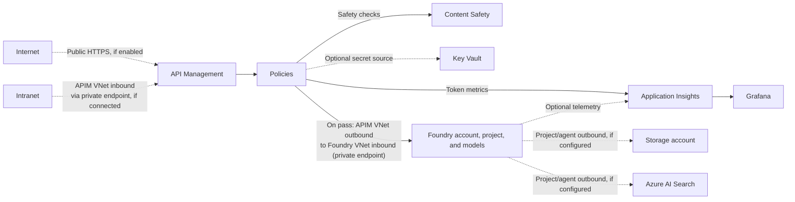

# Azure AI Foundry and APIM: Azure Portal administrator runbook

## Architecture overview



This is an anonymized conceptual view, not a live inventory. Dashed connections are optional or unverified. APIM uses secret named values in this runbook; [Key Vault-backed named values](https://learn.microsoft.com/azure/api-management/api-management-howto-properties) would require a managed identity and are not configured here. The [Foundry project/agent outbound path](https://learn.microsoft.com/azure/foundry/how-to/configure-private-link) is separate from inbound inference; its connections to storage, Azure AI Search, and telemetry are not established by this runbook.

The [detailed SVG](./docs/diagrams/apim-foundry-example.svg) and [editable Excalidraw diagram](./docs/diagrams/apim-foundry-example.excalidraw) show the core runbook configuration only.

## About this runbook

This runbook describes an example model, gateway, token-governance, Content Safety, and reporting configuration. All Azure configuration changes are made through browser portals, including the APIM policy code editor. There are no Terraform, Azure CLI, Cloud Shell, or application-code deployment steps. Section 9.4 adds an optional local PowerShell step for Windows desktop clients.

> **Anonymized examples:** Resource names, deployment names, tenant/subscription/application identifiers, endpoints, and dashboard names in this runbook are fictitious or placeholders. Hosts under `example.invalid` do not resolve. Replace these examples consistently with your own environment's values before using any portal instructions, templates, policies, or queries. Never put actual keys in this document.
>
> **Configuration:** Use four independent model APIs, products, and product-scoped subscriptions. Do not recreate a combined gateway route.

> **Assumptions:** APIM, Foundry, the Foundry project, storage, Application Insights and its workspace, Content Safety, networking, private endpoints, and the Azure Monitor/Application Insights implicit Grafana experience are already available. Subscription-level `Microsoft.Dashboard` registration is resolved. Infrastructure creation and identity provisioning are outside this runbook.

## Contents

[Architecture overview](#architecture-overview)

1. [Resource names and final configuration](#1-resource-names-and-final-configuration)
2. [Open the correct directory and subscription](#2-open-the-correct-directory-and-subscription)
3. [Deploy and configure the Foundry models](#3-deploy-and-configure-the-foundry-models)
4. [Store backend keys in APIM](#4-store-backend-keys-in-apim)
5. [Connect APIM to Application Insights](#5-connect-apim-to-application-insights)
6. [Create the key-authenticated Content Safety fragment](#6-create-the-key-authenticated-content-safety-fragment)
7. [Publish the four model APIs](#7-publish-the-four-model-apis)
8. [Apply token, routing, and safety policies](#8-apply-token-routing-and-safety-policies)
9. [Configure products and subscriptions](#9-configure-products-and-subscriptions)
10. [Enable and verify token reporting](#10-enable-and-verify-token-reporting)
11. [Import the Grafana report inside Application Insights](#11-import-the-grafana-report-inside-application-insights)
12. [Portal validation and operational checks](#12-portal-validation-and-operational-checks)
13. [Appendix A: Content Safety fragment](#appendix-a-content-safety-fragment)
14. [Appendix B: per-model API policy](#appendix-b-per-model-api-policy)
15. [References](#references)

## 1. Resource names and final configuration

### Existing Azure resources

Open the [Azure Portal](https://portal.azure.com/) and select your resource group.

| Item | Example name/value |
|---|---|
| Directory | `<TENANT_DOMAIN>` |
| Tenant ID | `<TENANT_ID>` |
| Subscription | `<AZURE_SUBSCRIPTION_NAME>` / `<AZURE_SUBSCRIPTION_ID>` |
| Resource group | `example-resource-group` |
| Region | `<AZURE_REGION>` / `<AZURE_REGION_CODE>` |
| Foundry account | `example-foundry` |
| Foundry project | `example-project` |
| APIM service | `example-apim` |
| APIM tier | `Standard v2` |
| Application Insights | `example-app-insights` |
| Application Insights App ID | `<APPLICATION_INSIGHTS_APP_ID>` |
| Linked Log Analytics workspace | `example-log-analytics-workspace` |
| Dedicated Content Safety account | `example-content-safety`, SKU `S0` |
| VNet | `example-vnet` |
| APIM outbound subnet | `example-apim-subnet` |
| Foundry private-endpoint subnet | `example-foundry-subnet` |
| Foundry private endpoint | `example-foundry-private-endpoint` |
| APIM inbound private endpoint | `example-apim-private-endpoint` |

The linked workspace can be in a separate managed resource group, not necessarily `example-resource-group`. Existing storage is assumed ready; this runbook does not change storage settings.

Use **`example-app-insights`**, not the similarly named `example-app-insights-alternate`.

### Authentication and networking boundaries

- Azure Portal administration uses the administrator's existing Entra sign-in and permissions. This is management access, not an authentication integration added to the deployed APIs.
- Clients authenticate to APIM with **subscription keys**.
- APIM authenticates to Foundry and Content Safety with **API keys** stored as secret named values.
- Application Insights ingestion uses its existing **instrumentation key** connection.
- Do not add OAuth/OpenID settings, JWT validation, managed-identity backend authentication, app registrations, or new role assignments.
- Keep Foundry **public network access disabled** and local/API-key authentication enabled. Its private connectivity is precreated.
- This example assumes that the dedicated Content Safety resource has **public network access enabled**, API-key authentication enabled, and no managed identity. APIM calls it over HTTPS. Do not open Foundry public access to make Content Safety work.
- Grafana reporting uses the precreated Azure Monitor connection in the **Application Insights embedded Grafana experience**. Do not create a separate Managed Grafana workspace.

### Model deployments

These catalog models and deployment names are examples. Confirm model availability, versions, and allocations in your own environment.

| Catalog model | Example deployment name | Publisher format | Version | Deployment type | Model TPM allocation | Capacity units / RPM |
|---|---|---|---|---|---:|---:|
| DeepSeek V4.1 Flash | `example-deepseek-deployment` | `DeepSeek` | `2026-10-17` | Global Standard | 10,000,000 | 10,000 |
| Kimi K3.1 Pro | `example-kimi-deployment` | `MoonshotAI` | `2026-11-04` | Global Standard | 5,000,000 | 5,000 |
| Claude Sonnet 5.5 | `example-sonnet-deployment` | `Anthropic`, hosted on Azure | `2` | Global Standard | 10,000,000 | 10,000 |
| GPT Sol 6.1 | `example-gpt-deployment` | `OpenAI` | `2026-09-29` | Global Standard | 10,000,000 | 10,000 |

Configure and verify **`Microsoft.DefaultV2`** on all four deployments. Available provider-specific safety features can differ; retain the APIM Content Safety checks for every model. The DeepSeek release was cataloged as preview; confirm the current lifecycle status before production use.

The model allocations above are different from the deliberately lower **APIM consumer limits** below.

### Gateway settings

| Setting | Final value |
|---|---|
| Access model | One API, product, and subscription per model; no combined subscription |
| Public base URL | `https://gateway.example.invalid` |
| DeepSeek operation | `POST /example-deepseek/chat/completions` |
| Kimi operation | `POST /example-kimi/chat/completions` |
| GPT operation | `POST /example-gpt/chat/completions` |
| Sonnet operation | `POST /example-sonnet/messages` |
| Chat Completions backend | `https://foundry.example.invalid/openai/v1/chat/completions` |
| Sonnet Messages backend | `https://foundry.example.invalid/anthropic/v1/messages` |
| Client API version query | Not required on the per-model endpoints |
| Tokens/minute per subscription | `100000` |
| Daily token quota per subscription | `1000000`, period `Daily` |
| Prompt estimation | Disabled; use actual response usage consistently across all four models |
| Consumed-token header | `x-tokens-consumed` |
| Remaining-minute header | `x-ratelimit-remaining-tokens` |
| Remaining-daily-quota header | `x-ratelimit-remaining-daily-tokens` |
| Token metric namespace | `example-foundry-models` |
| Custom metric dimensions | `API ID`, `Subscription ID`, `Model` |
| Content Safety text mode | `EightSeverityLevels` |
| Moderation rule | Allow severity `0`; block `1` through `7` in all four categories |
| Prompt shields | User and document attack checks enabled |
| Custom keyword blocklists | Not configured |
| Safety text limit | `10000` Unicode code points; reject longer text, do not truncate |
| Product approval | Disabled |
| Subscription required | Enabled |

> **Set the harm threshold carefully:** a literal APIM harm threshold of `0` blocks even harmless severity-0 content. The example rule blocks `>= 1`. Do not rely on OpenAI prompt-token estimation for DeepSeek and Kimi; the provided policies consistently use actual response usage for all four models.

### Per-model access reference

Each row has its own published product and active subscription. All four products require subscription keys and have **Approval required** disabled.

| Model | API and product identifier | Subscription identifier | Public POST path |
|---|---|---|---|
| DeepSeek V4.1 Flash | `example-deepseek` | `example-deepseek-subscription` | `/example-deepseek/chat/completions` |
| Kimi K3.1 Pro | `example-kimi` | `example-kimi-subscription` | `/example-kimi/chat/completions` |
| Claude Sonnet 5.5 | `example-sonnet` | `example-sonnet-subscription` | `/example-sonnet/messages` |
| GPT Sol 6.1 | `example-gpt` | `example-gpt-subscription` | `/example-gpt/chat/completions` |

Prefix each path with the APIM gateway URL from section 1. The example deployment names in the previous table are distinct from these API/product identifiers; use the corresponding values consistently in your environment.

For every model, clients send the **APIM product subscription key** using `Ocp-Apim-Subscription-Key`. In particular, Sonnet clients do not need a Foundry `x-api-key`: APIM injects that backend credential. Do not copy backend keys into a client.

## 2. Open the correct directory and subscription

1. Use the administrator's **already authenticated Microsoft Edge profile**.
2. Open [Azure Portal](https://portal.azure.com/).
3. Select the account/directory control in the upper-right corner.
4. Select **Switch directory** and choose `<TENANT_DOMAIN>`.
5. Open **Subscriptions** and select `<AZURE_SUBSCRIPTION_NAME>`.
6. Verify subscription ID `<AZURE_SUBSCRIPTION_ID>`.
7. Open **Resource groups** > **example-resource-group**.

The administrator must already have permission to manage these resources, create/edit APIM APIs and policies, read the relevant resource keys, read Application Insights data, and save Grafana dashboard resources. `Microsoft.Dashboard` registration and dashboard/data-source access are assumed resolved; do not provision identities as part of this procedure.

## 3. Deploy and configure the Foundry models

Azure Portal opens the Microsoft Foundry browser portal for the model catalog and deployment screens. This remains a portal-only procedure.

### 3.1 Open the existing project

1. In the resource group, open **example-foundry**.
2. On **Overview**, select **Go to Foundry portal** / **Open in Foundry**.
3. In the Foundry project selector, select **example-project** under this account.
4. Confirm the account, project, subscription, and region before continuing.

Foundry model deployments are account-level resources available to the project; do not create a second account or project.

### 3.2 Deploy DeepSeek

1. Open **Model catalog** / **Discover** > **Models**.
2. Search for **DeepSeek V4.1 Flash**.
3. Select the **Azure-sold/native** offering with format/publisher `DeepSeek`.
4. Do not select a Hugging Face managed-compute deployment template or an `FW-` Fireworks offering.
5. Select **Deploy** / **Use this model**.
6. Select the existing account/project if prompted.
7. Set:
   - **Deployment name:** `example-deepseek-deployment`
   - **Version:** `2026-10-17`
   - **Deployment type / Token plan:** **Global Standard**, pay-per-token
   - **Tokens per minute rate limit:** `10,000,000`, if still available
   - **Guardrails / Content filter:** **DefaultV2** / `Microsoft.DefaultV2`
8. Review and select **Deploy**.
9. Open **Deployments** / **Models + endpoints** and wait for **Succeeded**.

If the quota slider cannot reach this allocation, use the available quota and record the actual allocation. Do not claim the example allocation was applied when the subscription cannot allocate it.

### 3.3 Deploy Kimi

Repeat the model-catalog procedure with:

- **Catalog model:** Kimi K3.1 Pro
- **Example deployment name:** `example-kimi-deployment`
- **Native publisher format:** `MoonshotAI`
- **Version:** `2026-11-04`
- **Deployment type:** **Global Standard**, pay-per-token
- **TPM:** `5,000,000`, if still available
- **Guardrails:** **DefaultV2** / `Microsoft.DefaultV2`

Do not use `FW-Kimi-K3` or enable Fireworks for this runbook. Use the native Kimi model instead.

### 3.4 Deploy Claude Sonnet 5.5

1. In the same **example-project** model catalog, select **Claude Sonnet 5.5**.
2. Select **Deploy** > **Custom settings**.
3. Select **Version 2: Hosted on Azure**, not version 1 hosted on Anthropic infrastructure.
4. Review the provider/Marketplace terms and submit your organization's accurate industry, country, and legal-entity details. Do not include those details in this runbook.
5. Set **Deployment name:** `example-sonnet-deployment`, **Global Standard**, and up to **10,000,000 TPM** of available allocation.
6. Deploy and wait for **Succeeded**.
7. Verify version `2` and the persisted guardrail configuration.

The native inference protocol is **Anthropic Messages**, not OpenAI Chat Completions. Sonnet clients use `max_tokens`; their top-level `system` content must also be checked by the gateway safety policy.

### 3.5 Deploy GPT Sol 6.1

Repeat the native model-catalog procedure with:

- **Catalog model:** GPT Sol 6.1
- **Example deployment name:** `example-gpt-deployment`
- **Publisher format:** `OpenAI`
- **Version:** `2026-09-29`
- **Deployment type:** **Global Standard**, pay-per-token
- **TPM:** up to `10,000,000`, if available
- **Guardrails:** **DefaultV2** / `Microsoft.DefaultV2`

Wait for **Succeeded**. GPT uses **Chat Completions** and its native completion limit is `max_completion_tokens`. The gateway normalization below also accepts `max_tokens`, but rejects requests that provide both.

### 3.6 Verify Foundry configuration

1. Open each deployment's **Details** / **Edit** configuration.
2. Verify deployment name, exact version, Global Standard type, allocation, **Succeeded**, and **DefaultV2**.
3. Open **Guardrails + controls** / **Content filters** if necessary to confirm the deployment's filter association.
4. Keep the built-in DefaultV2 behavior. It includes the standard harm-category controls, prompt-attack protection, and protected-material checks; some checks, such as protected code, can be annotation-only in the default configuration.
5. Do not enable unsupported dynamic-quota or automatic-version-upgrade options just to make every switch appear selected.
6. Return to the Azure Portal account's **Networking** and verify **public access remains disabled**.
7. Verify the existing private endpoint is **Approved**.
8. Open **Keys and Endpoint** and confirm local/API-key access is available. Do not disable local authentication.

The Kimi deployment can return the provider's canonical response model name **`Kimi-K3.1`**. That response label alone does not mean a different deployment was selected.

## 4. Store backend keys in APIM

Keep real keys out of this document, dashboard JSON, policy XML, screenshots, and client URLs.

### 4.1 Foundry key

1. Open **example-foundry** > **Keys and Endpoint**.
2. Copy **KEY 1** using the portal copy control.
3. Open **example-apim**.
4. Select **APIs** > **Named values** > **+ Add**.
5. Set:
   - **Name / identifier:** `example-foundry-key`
   - **Display name:** `example-foundry-key`
   - **Type:** **Secret**
   - **Value:** the Foundry key
6. Select **Save**.

This secret is the **account key used by all four model backends**. It is not a combined client subscription key.

### 4.2 Content Safety key

1. Open **example-content-safety** > **Keys and Endpoint**.
2. Confirm SKU `S0`, the existing HTTPS endpoint, and API-key access.
3. Copy **KEY 1**.
4. In APIM **Named values**, add:
   - **Name / display name:** `example-foundry-content-safety-key`
   - **Type:** **Secret**
   - **Value:** the Content Safety key
5. Select **Save**.

Use the dedicated endpoint:

```text
https://content-safety.example.invalid/
```

Do not replace it with the Foundry Cognitive Services endpoint. Verify that APIM can reach the dedicated Content Safety endpoint without opening Foundry public access.

### 4.3 Existing backend inventory

An existing APIM backend record such as **`example-foundry-backend`** may reference the Foundry `/openai/v1` URL and an `api-key` named value.

The **final policies below do not depend on that backend record**. They explicitly select the native backend base URL and set the Foundry `api-key` header (or `x-api-key` for Sonnet) after safety checks. Do not substitute backend-ID credential handling for this final transport without retesting all affected models.

## 5. Connect APIM to Application Insights

### 5.1 Create or verify the logger connection

1. In **example-apim**, select **Monitoring** > **Application Insights**.
2. Select **+ Add**.
3. Choose **example-app-insights** in the existing subscription/resource group.
4. Choose the existing instrumentation-key connection; do not enable managed identity or add a role assignment.
5. Use the connection/logger name **`example-appinsights-logger`** where the form exposes a name.
6. Select **Create** / **Save**.
7. Verify the connection points to **example-app-insights**, not a similarly named resource.

If the portal assigns a different internal logger identifier, use that actual connection when configuring the API diagnostics. The policy does not hard-code this logger ID.

Leave unrelated existing loggers and global diagnostic connections unchanged.

### 5.2 API diagnostics settings to apply after API creation

For **each of the four APIs** created in section 7:

1. Open **APIs** > the API > **Settings**.
2. Find **Diagnostics logs** / **Application Insights**.
3. Enable logging and choose **example-appinsights-logger** / the connection to **example-app-insights**.
4. Set **Sampling:** `100%`.
5. Set **Always log errors:** enabled / **All errors**.
6. Set **Verbosity:** **Information**.
7. Use **W3C** HTTP correlation; enable correlation headers where exposed.
8. Set **Log client IP:** off.
9. For frontend and backend request/response logging:
   - **Body bytes:** `0`
   - **Headers to log:** none
10. Enable **Track token usage / custom metrics** in the API's AI/diagnostics settings where exposed and save.

The diagnostic entity's effective setting must be **`metrics: true`**, in addition to the token-emission policy. Merely connecting a logger does not enable token metrics.

If the portal's **Track token usage / custom metrics** control sets this flag, use that control. If it is not exposed, use the following **Azure Portal template-editor** procedure. This is still a portal-only configuration change: no CLI, REST client, Terraform, or application deployment is used.

### 5.3 Portal-only advanced diagnostic configuration

Do this only after the API and its Application Insights logger exist.

1. In the Azure Portal search bar, search for **Deploy a custom template**.
2. Open **Deploy a custom template**.
3. Select **Build your own template in the editor**.
4. Paste the configuration template below. Replace both `example-apim` references with your APIM service name and update `allowedValues` if your API identifiers differ, then select **Save**.
5. On **Custom deployment** > **Basics**, select:
   - **Subscription:** `<AZURE_SUBSCRIPTION_NAME>`
   - **Resource group:** `example-resource-group`
   - **Region:** `<AZURE_REGION>`
   - **Api Name:** the first API identifier from section 7
   - **Logger Name:** `example-appinsights-logger`, or the actual logger name assigned in section 5.1
6. Select **Review + create** > **Create**.
7. Wait for **Deployment succeeded**.
8. Repeat for the other three API identifiers.

The template updates only the existing API's `applicationinsights` diagnostic. It does not create an APIM service, Application Insights resource, identity, or role assignment. Keep all prompt/response body and header logging disabled.

```json
{
  "$schema": "https://schema.management.azure.com/schemas/2019-04-01/deploymentTemplate.json#",
  "contentVersion": "1.0.0.0",
  "parameters": {
    "apiName": {
      "type": "string",
      "allowedValues": ["example-deepseek", "example-kimi", "example-sonnet", "example-gpt"]
    },
    "loggerName": {
      "type": "string",
      "defaultValue": "example-appinsights-logger"
    }
  },
  "resources": [
    {
      "type": "Microsoft.ApiManagement/service/apis/diagnostics",
      "apiVersion": "2024-05-01",
      "name": "[concat('example-apim/', parameters('apiName'), '/applicationinsights')]",
      "properties": {
        "loggerId": "[resourceId('Microsoft.ApiManagement/service/loggers', 'example-apim', parameters('loggerName'))]",
        "metrics": true,
        "alwaysLog": "allErrors",
        "sampling": {"samplingType": "fixed", "percentage": 100},
        "logClientIp": false,
        "verbosity": "information",
        "httpCorrelationProtocol": "W3C",
        "enableHttpCorrelationHeaders": true,
        "frontend": {
          "request": {"headers": [], "body": {"bytes": 0}},
          "response": {"headers": [], "body": {"bytes": 0}}
        },
        "backend": {
          "request": {"headers": [], "body": {"bytes": 0}},
          "response": {"headers": [], "body": {"bytes": 0}}
        }
      }
    }
  ]
}
```

## 6. Create the key-authenticated Content Safety fragment

The native APIM **`llm-content-safety`** policy requires managed-identity backend authentication in the documented configuration. It is therefore **not** the implementation used here.

1. Open **example-apim** > **APIs** > **Policy fragments**.
2. Select **+ Add**.
3. Set **Name:** `example-foundry-key-content-safety`.
4. Enter a description such as **API-key text moderation and prompt/document shields**.
5. Open the fragment code editor.
6. Paste the complete `<fragment>` block from [Appendix A](#appendix-a-content-safety-fragment).
7. Select **Save**.

The fragment uses only `{{example-foundry-content-safety-key}}`; no actual key is pasted into XML. It:

- Analyzes textual message content using eight severity levels.
- Blocks any Hate, SelfHarm, Sexual, or Violence result at severity `1` or above.
- Checks user prompts and non-user textual context for prompt/document attacks.
- Rejects text over 10,000 Unicode code points instead of truncating it.
- Fails closed if the service is unavailable or returns an invalid response.
- Leaves image-only/non-text moderation to the existing model guardrails; it does not claim that images were text-moderated.
- Does not configure custom keyword blocklists.

These APIM checks apply to **request text**, including Sonnet's top-level `system` text when its native policy adaptation is used. They do not add an APIM completion-moderation stage. Keep the existing Foundry/provider output guardrails enabled separately.

Do not also enable the managed-identity Content Safety wizard checkbox. The key-authenticated fragment provides the requested safety behavior without adding an Entra integration.

## 7. Publish the four model APIs

Manual HTTP API creation gives the exact final route and policy control. No OpenAPI URL or external application code is required.

### 7.1 Create the API definitions

For each row below:

1. In APIM, select **APIs** > **+ Add API** > **HTTP** / **Manually define an HTTP API**.
2. Select **Full** / advanced form if the identifier is not initially visible.
3. Enter the exact **Name / API identifier**, display name, and URL suffix.
4. Set **Web service URL** to `https://foundry.example.invalid/openai/v1` for DeepSeek, Kimi, and GPT; for Sonnet use `https://foundry.example.invalid/anthropic/v1`.
5. Allow **HTTPS** only.
6. Leave OAuth/OpenID authentication settings unset.
7. Enable **Subscription required**.
8. Use subscription-key header **`Ocp-Apim-Subscription-Key`**.
9. Select **Create** / **Save**.

| API identifier | Display name | API URL suffix |
|---|---|---|
| `example-deepseek` | Example DeepSeek | `example-deepseek` |
| `example-kimi` | Example Kimi | `example-kimi` |
| `example-sonnet` | Example Sonnet | `example-sonnet` |
| `example-gpt` | Example GPT | `example-gpt` |

Do not add a duplicate API if the intended definition already exists. Update that definition instead, preserving unrelated settings.

### 7.2 Add the native model operations

1. Select the API > **Design** > **+ Add operation**.
2. Enter the following method, URL template, and operation identifier.
3. Do not define a deployment-name path parameter; each API policy pins its own model.
4. Add an **application/json** request representation where the form exposes it.
5. Select **Save**.

| API | Operation identifier | Method | URL template |
|---|---|---|---|
| `example-deepseek` | `chat-completions` | POST | `/chat/completions` |
| `example-kimi` | `chat-completions` | POST | `/chat/completions` |
| `example-sonnet` | `messages` | POST | `/messages` |
| `example-gpt` | `chat-completions` | POST | `/chat/completions` |

The client URLs are:

```text
https://gateway.example.invalid/example-deepseek/chat/completions
https://gateway.example.invalid/example-kimi/chat/completions
https://gateway.example.invalid/example-sonnet/messages
https://gateway.example.invalid/example-gpt/chat/completions
```

The earlier combined Azure OpenAI deployment-path API has been removed. Do not use the former account-name URL prefix, create combined products/subscriptions, or add deployment-path operations to these independent APIs.

For an OpenAI-compatible client, use a custom `base_url` ending in the relevant API suffix and supply the APIM subscription key in `Ocp-Apim-Subscription-Key`. Do not use an SDK mode that automatically inserts `/openai/deployments/...`. For Sonnet use an Anthropic Messages-compatible client and its dedicated `/messages` endpoint.

## 8. Apply token, routing, and safety policies

### 8.1 Per-model API policy

1. Select **APIs** > the model's API > **Design**.
2. Select **All operations**.
3. Open the policy **Code editor** (`</>`) for the full policy document.
4. Paste [Appendix B](#appendix-b-per-model-api-policy), replacing the API-level policy document only, and apply the model-specific settings in section 8.2.
5. Select **Save** and resolve any validation errors before proceeding.

Do not duplicate `<forward-request>` by adding a backend `<base />` before the provided backend block. An inherited backend may already have a forward request.

Each API pins its own model. Product-scoped subscription keys can access only that product's associated API.

### 8.2 Model-specific policy settings

Repeat the **All operations** policy-editor procedure for all four APIs. Appendix B starts with the fixed DeepSeek variable. Set that variable to the model for the API:

For **example-deepseek**:

```xml
<set-variable name="selected-model" value="example-deepseek-deployment" />
```

For **example-kimi**:

```xml
<set-variable name="selected-model" value="example-kimi-deployment" />
```

For **example-gpt**:

```xml
<set-variable name="selected-model" value="example-gpt-deployment" />
```

For **example-sonnet**:

```xml
<set-variable name="selected-model" value="example-sonnet-deployment" />
```

The fixed variable overrides a client-supplied `model` field and must match the Foundry deployment name, not necessarily the API identifier. If your deployment names differ from the examples, also update the GPT and Kimi comparisons in Appendix B, the Logs query, and the dashboard model filters. DeepSeek, Kimi, and GPT use the Chat Completions transport in Appendix B. For Sonnet make these additional native-protocol changes in the same editor:

1. Replace the `example-foundry-generation-body` variable with:

   ```xml
   <set-variable id="client-body" name="example-foundry-generation-body" value='@{
     var body = context.Request.Body.As&lt;JObject&gt;(preserveContent: true);
     body["model"] = (string)context.Variables["selected-model"];
     return body.ToString();
   }' />
   ```

2. Immediately before `<include-fragment>`, insert the following temporary safety-body projection. It includes native top-level `system` text in moderation without changing the generation payload:

   ```xml
   <set-body id="client-system"><![CDATA[@{
     var body = JObject.Parse((string)context.Variables["example-foundry-generation-body"]);
     var messages = body["messages"] as JArray;
     if (messages == null || messages.Count == 0) { throw new Exception("messages must be a nonempty array"); }
     var system = body["system"];
     if (system != null && system.Type != JTokenType.Null) {
       if (system.Type != JTokenType.String && system.Type != JTokenType.Array) { throw new Exception("system must be text or text blocks"); }
       if (system.Type == JTokenType.Array) {
         foreach (var part in (JArray)system) {
           var item = part as JObject;
           if (item == null || (string)item["type"] != "text" || item["text"] == null || item["text"].Type != JTokenType.String) { throw new Exception("system blocks must contain text"); }
         }
       }
       var entry = new JObject(); entry["role"] = "system"; entry["content"] = system.DeepClone(); messages.Insert(0, entry);
     }
     return body.ToString();
   }]]></set-body>
   ```

3. Set the backend base URL to `https://foundry.example.invalid/anthropic/v1` and the rewrite template to `/messages`.
4. Remove any client `x-api-key` header along with the other caller credentials. Replace the final Foundry `api-key` override with:

   ```xml
   <set-header name="x-api-key" exists-action="override"><value>{{example-foundry-key}}</value></set-header>
   <set-header name="anthropic-version" exists-action="override"><value>2023-06-01</value></set-header>
   ```

5. Keep `generation-body-restore` after safety checks. Do not forward the temporary synthetic system message to the native model.
6. Use a single `<forward-request buffer-response="false" />` in the backend section for Sonnet and GPT. The bounded Kimi-only retry is retained only for the existing Kimi route.
7. Keep token limits, the native Messages-aware `llm-emit-token-metric` policy, the safety header, and the explicit `client-system` error handling.

### 8.3 Verify effective controls

In each API policy, verify:

- **`llm-token-limit`**: `100000` TPM, `1000000` quota, period `Daily`, actual-token accounting.
- The counter key contains **subscription ID only**, not API ID or model. This prevents a key holder from gaining another daily allowance by switching routes.
- The per-model request-rate counter includes subscription ID and selected model; limits are 5,000 RPM for Kimi and 10,000 RPM for the other models.
- **`include-fragment`** points to `example-foundry-key-content-safety`.
- **`llm-emit-token-metric`** emits namespace `example-foundry-models` and dimensions `API ID`, `Subscription ID`, `Model`.
- The original normalized inference body is saved and restored around the safety/helper policies.
- Client Authorization and credential headers are removed before the genuine Foundry key is applied.
- Any caller `api-version` parameter is removed **after** rewriting the backend URI.
- Streaming includes actual usage and does not buffer the SSE response.
- A maximum of one buffered-body retry is allowed only for a backend `404` on the known Kimi deployment. There is no general retry, alternate-model routing, or success fallback.

Finish the per-API diagnostic setup from [section 5.2](#52-api-diagnostics-settings-to-apply-after-api-creation), including [section 5.3](#53-portal-only-advanced-diagnostic-configuration) when the metrics flag is not exposed in the API settings UI.

## 9. Configure products and subscriptions

### 9.1 Products: publish, require keys, do not require approval

For each product:

1. Open **APIs** > **Products** > **+ Add**, or open the existing product.
2. Enter the exact product identifier and display name.
3. Enable **Requires subscription / Subscription required**.
4. Disable **Requires approval / Approval required**.
5. Set **State:** **Published**.
6. Save.
7. Open the product's **APIs** tab and select **+ Add** to associate the listed APIs.

| Product identifier | Display name | APIs |
|---|---|---|
| `example-deepseek` | Example DeepSeek | `example-deepseek` only |
| `example-kimi` | Example Kimi | `example-kimi` only |
| `example-sonnet` | Example Sonnet | `example-sonnet` only |
| `example-gpt` | Example GPT | `example-gpt` only |

**Approval disabled does not mean anonymous access.** Subscription keys remain required.

Do not disable subscription protection on an API, create an anonymous product, or alter unrelated products.

### 9.2 Create the subscription keys

1. Open **APIs** > **Subscriptions** > **+ Add subscription**.
2. Enter the exact subscription identifier/name below.
3. Select **Scope:** **Product** and choose the corresponding product.
4. Leave the owner/user unassigned where the form supports a standalone subscription.
5. Set **State:** **Active**.
6. Save.

| Subscription identifier | Product scope | Access |
|---|---|---|
| `example-deepseek-subscription` | `example-deepseek` | DeepSeek API only |
| `example-kimi-subscription` | `example-kimi` | Kimi API only |
| `example-sonnet-subscription` | `example-sonnet` | Sonnet API only |
| `example-gpt-subscription` | `example-gpt` | GPT API only |

Use existing active subscriptions instead of replacing or regenerating their keys. Leave the existing service-wide **master** subscription unchanged.

The portal's default master key can access the APIs for administration. Use the actual product-scoped keys, not the master key, when validating customer isolation.

### 9.3 How clients authenticate

Clients send:

```text
Ocp-Apim-Subscription-Key: <APIM product subscription key>
Content-Type: application/json
```

They do not send Foundry or Content Safety resource keys, Entra tokens, or instrumentation keys.

Each product-scoped subscription has its own daily budget. The combined subscription no longer exists; do not reuse its old key.

### 9.4 Set the desktop client's environment variable (Windows)

1. Open **PowerShell** on the desktop that will run the Python client.
2. Replace `?????` with your **APIM product subscription key**, then run:

   ```powershell
   [System.Environment]::SetEnvironmentVariable("APIM_SUBSCRIPTION_KEY", "?????", "User")
   ```

3. Fully close and reopen **VS Code** so it inherits the saved user environment variable, then open a new terminal and run the Python client.

This persists the variable for your Windows user account; it does not update already-running processes. No Azure subscription ID is needed. Keep the actual key out of source code and this document.

### 9.5 Remove the retired combined APIM resources

If an environment still contains retired combined resources, identify them from its own configuration records before performing this portal-only cleanup. The placeholders below are not actual resource names; skip any entry that is already absent.

| Kind | Retired display name | Retired identifier |
|---|---|---|
| Subscription | `<LEGACY_SUBSCRIPTION_NAME>` | `<LEGACY_SUBSCRIPTION_ID>` |
| Product | `<LEGACY_PRODUCT_NAME>` | `<LEGACY_PRODUCT_ID>` |
| API | `<LEGACY_API_NAME>` | `<LEGACY_API_ID>` |

1. Open the appropriate APIM service > **APIs** > **Subscriptions**.
2. Locate only `<LEGACY_SUBSCRIPTION_NAME>`, verify its identifier, and select **Delete**. Do not delete or regenerate any of the four model-specific subscriptions.
3. Open the DeepSeek product's **APIs** tab. If the combined OpenAI API is listed, remove that **product association** only; retain the DeepSeek API association.
4. Repeat for the Kimi product, retaining the Kimi association.
5. Open `<LEGACY_PRODUCT_NAME>` and delete only that combined product. Inspect its subscriptions first; stop if other, unexpected subscriptions would also be deleted.
6. Open `<LEGACY_API_NAME>` and delete only that API, including its revisions if the confirmation asks.
7. Refresh the API, product, and subscription lists. Verify that the three retired entries are absent and that the four entries in the per-model access reference remain present.
8. Re-test each model using its own product key and public path. Stop using the former combined route and its deleted subscription key.

Do **not** delete the Foundry account/project/model deployments, Content Safety account, secret named values, `example-foundry-key-content-safety` policy fragment, Application Insights logger, or the service-wide master subscription. Those are not retired combined client resources and are still used by the retained APIs.

## 10. Enable and verify token reporting

### 10.1 Application Insights Logs

1. Open **example-app-insights** in Azure Portal.
2. Select **Logs**.
3. Dismiss the example-query gallery if it covers the editor.
4. Set a time range containing the test requests, such as **Last 24 hours**.
5. Paste and select **Run**:

```kql
customMetrics
| where timestamp > ago(24h)
| where name in ("Prompt Tokens", "Completion Tokens", "Total Tokens")
| extend Model = tostring(customDimensions["Model"]),
         Subscription = tostring(customDimensions["Subscription ID"]),
         API = tostring(customDimensions["API ID"])
| where Model in ("example-deepseek-deployment", "example-kimi-deployment", "example-sonnet-deployment", "example-gpt-deployment")
| summarize Tokens = sum(coalesce(valueSum, value))
    by Model, Subscription, API, Metric = name
| order by Model asc, Metric asc
```

Allow time for APIM buffering and Application Insights ingestion. Do not interpret an immediately empty result as proof that the policy was not installed.

Use the **classic Application Insights `customMetrics` schema** for this resource-context report and a dashboard compatible with that schema. Do not replace it with `AppMetrics` without changing and validating the queries.

### 10.2 Correct token accounting

- **Input:** `Prompt Tokens`
- **Output:** `Completion Tokens`
- **Total:** `Total Tokens`, or Input + Output for the breakdown table
- Sum `coalesce(valueSum, value)` because telemetry can be preaggregated.
- Do not use row count or `valueCount` as the token count.
- Do not add reasoning/cache/prediction categories to Total again; they can already be included in prompt/completion totals.
- Do not sum the separate aggregate `azure.ai_gateway.client.token.usage` series with these totals.

Custom dimensions configured by the policy are **API ID, Subscription ID, Model**. Standard dimensions can also include **Region, Service ID, Service Name, Service Type**. User ID and Client IP are not included in this example report.

### 10.3 Optional Metrics Explorer dimension splitting

For split-by-dimension charts in the **Metrics** blade:

1. In Application Insights, select **Usage and estimated costs**.
2. Select **Custom metrics (Preview)**.
3. Select **With dimensions**.
4. Select **OK** / **Save**.
5. Return to **Metrics**, choose namespace **example-foundry-models**, and inspect the token metrics and available split dimensions after new telemetry arrives.

This optional UI setting can be applied manually. A Grafana report using **Logs dimensions** does **not** require this Metrics Explorer opt-in.

## 11. Import the Grafana report inside Application Insights

Use the **existing implicit Grafana experience in Azure Portal**, not a new standalone Grafana server and not a new Managed Grafana workspace.

Use a four-model Grafana dashboard JSON from an approved source and save it locally so the portal file picker can select it. Update its model selector and panel queries to use your deployment names. This runbook does not sanitize dashboard files: before sharing a dashboard, separately remove customer-specific resource IDs, names, endpoints, titles, UIDs, and tags.

### 11.1 Import the dashboard

1. In Azure Portal, open **example-app-insights**.
2. Select **Dashboards with Grafana** in the left menu.
3. In the embedded Grafana/gallery interface, select **New** > **Import**.
4. Choose **Upload JSON file** / the file picker.
5. Select the dashboard JSON file.
6. Select **Load**.
7. Use a non-identifying title, such as **Example Foundry - Input and Output Tokens**.
8. If the importer asks to resolve **Existing Azure Monitor datasource / DS_AZURE_MONITOR**, select the existing built-in/preconfigured **Azure Monitor** datasource. Do not add credentials or create a new datasource identity.
9. Verify the destination:
   - **Subscription:** `<AZURE_SUBSCRIPTION_NAME>` / `<AZURE_SUBSCRIPTION_ID>`
   - **Resource group:** `example-resource-group`
   - **Region:** `<AZURE_REGION>`
10. Select **Import** / **Save** to complete the form.
11. If the imported view is not yet saved, select **Save** / **Save As**, confirm these destination fields, and save it as a dashboard Azure resource.

Use a non-identifying dashboard UID, such as **`example-foundry-token-report`**. The UID is not the name of a Grafana workspace.

### 11.2 Verify and, if necessary, map the panel datasource

1. Open the saved dashboard and select **Edit**.
2. Open each panel's **Edit** > **Query** editor.
3. Verify:
   - **Datasource:** the existing **Azure Monitor** datasource
   - **Service/query type:** **Azure Log Analytics**
   - **Resource:** **example-app-insights**
   - **Resource ID:**

```text
/subscriptions/<AZURE_SUBSCRIPTION_ID>/resourceGroups/example-resource-group/providers/Microsoft.Insights/components/example-app-insights
```

4. Use **Table** result format for the stat/table panels and **Time series** for the trend panel.
5. Keep `timestamp` as the time column and the supplied `customMetrics` queries/macros.
6. If the importer did not resolve `${DS_AZURE_MONITOR}`, select the existing Azure Monitor datasource for every panel in the query editor and save. Do not leave an unresolved datasource placeholder.
7. Select **Apply**, then save the dashboard.

This is an Application Insights **resource-context** query, not an instruction to create a new workspace, ADX cluster, service principal, or identity connection.

### 11.3 Dashboard panels and filters

Verify these five panels:

1. **Input tokens**
2. **Output tokens**
3. **Total tokens**
4. **Input / Output over time**
5. **Input / Output by selected dimension**

Set **Time range:** Last 24 hours and **Refresh:** 1 minute.

Use:

- **Model:** All, or one of the four deployment names from section 3.
- **Break down by:** Model, Subscription, API, Region, Service ID, Service name, or Service type.

Reimport the updated dashboard JSON when adding models. Updating a local file does not automatically update an already saved portal dashboard. All five panel queries must include the new models; adding dropdown options alone is insufficient. Compare the chart/table totals with Application Insights Logs for the same time range.

Validate the dashboard query variants against your Application Insights resource. Sonnet's native input/output usage is emitted through APIM as the same **Prompt Tokens**, **Completion Tokens**, and **Total Tokens** metrics used for the other models, with the selected Sonnet deployment name as `Model`.

### 11.4 Ensure it appears in the App Insights gallery

Dashboards created/imported **inside Application Insights** receive the gallery tag automatically. If the dashboard was imported through the top-level **Azure Monitor** gallery instead:

1. Open the saved dashboard Azure resource.
2. Select **Tags**.
3. Add:
   - **Name:** `GrafanaDashboardResourceType`
   - **Value:** `microsoft.insights/components`
4. Save.
5. Return to **example-app-insights** > **Dashboards with Grafana** and refresh **Saved dashboards**.

Ordinary JSON tags such as `example` and `tokens` do not replace this Azure resource tag.

Dashboard readers/editors and the existing Azure Monitor datasource permissions are assumed preconfigured. A dashboard share link does not grant access to its underlying Application Insights data.

## 12. Portal validation and operational checks

### 12.1 Test the model APIs from APIM

1. Open **example-apim** > **APIs** > **example-deepseek**.
2. Select **chat-completions** > **Test**.
3. Use the DeepSeek product subscription, not the default master key.
4. Set its actual `Ocp-Apim-Subscription-Key` header and **Content-Type = application/json**.
5. Do not add a deployment path or `api-version` query parameter.
6. Paste:

```json
{
  "messages": [{"role": "user", "content": "Say hello briefly."}],
  "max_tokens": 128
}
```

7. Select **Send**.
8. Expect **200**, a chat-completion response, usage totals, and:
   - `x-ai-content-safety: passed`
   - `x-tokens-consumed`
   - `x-ratelimit-remaining-tokens`
   - `x-ratelimit-remaining-daily-tokens`
9. Repeat on **example-kimi** > **chat-completions** using the Kimi product key.
10. Repeat on **example-gpt** > **chat-completions** using its product key and this native body:

```json
{
  "messages": [{"role": "user", "content": "Reply with exactly OK."}],
  "max_completion_tokens": 512,
  "reasoning_effort": "low"
}
```

11. For **example-sonnet** > **messages**, use its product key and this native Messages body:

```json
{
  "system": "You are a helpful assistant.",
  "messages": [{"role": "user", "content": "Reply with exactly OK."}],
  "max_tokens": 128
}
```

Expect a native `content` array and `usage.input_tokens` / `usage.output_tokens` for Sonnet, rather than OpenAI `choices`. The API pins the deployment; a body `model` field is not required.

### 12.2 Validate access and safety

Use the APIM Test tab with real product-scoped keys:

| Test | Expected result |
|---|---|
| Missing/invalid subscription key | `401` |
| Any model's product key used on another model's API | `401` |
| Caller supplies another body model on an authorized API | Authorized API pins its own model |
| Former combined API URL | `404` after gateway configuration propagation |
| Malformed JSON/messages/streaming options | `400 invalid_request_body` |
| Detected user/document prompt attack | `403 prompt_attack_detected` |
| Moderation severity 1-7 | `403 content_blocked` |
| More than 10,000 Unicode code points of collected text | `403 content_safety_input_limit` |
| Content Safety outage/authentication/invalid response | `503 content_safety_unavailable`; no generation |
| Valid image-only/non-text request | Safety header `no-text`; existing model guardrails still apply |

Use only harmless verification prompts. Do not produce harmful content just to exercise the filters.

### 12.3 Streaming

In the Test request body, add:

```json
{
  "messages": [{"role": "user", "content": "Reply with exactly OK."}],
  "max_tokens": 128,
  "stream": true,
  "stream_options": {"include_usage": true}
}
```

For DeepSeek, Kimi, and GPT, verify **200**, SSE content type, completion, final usage, and `[DONE]`. The policy forces `include_usage: true` even if the client supplied false. For GPT use `max_completion_tokens` instead of `max_tokens`.

For Sonnet, use its native body with `"stream": true` and **omit `stream_options`**. Expect `message_start`, `message_delta`, and `message_stop` events with native input/output usage; Anthropic streams do not use OpenAI's `[DONE]` marker.

A client interruption can make streaming token telemetry incomplete. Do not classify missing final usage on an interrupted stream as zero consumption.

### 12.4 Administrator checklist

- [ ] Correct directory, subscription, resource group, account and `example-project`.
- [ ] All four exact native deployments are Succeeded, with recorded allocation and guardrail settings.
- [ ] Foundry remains private and API-key authentication remains enabled.
- [ ] Dedicated Content Safety S0 endpoint is reachable and keyed; no managed identity added.
- [ ] Both backend keys are secret named values, never literal XML/dashboard values.
- [ ] All four APIs require subscription keys and have the correct native operations.
- [ ] All four products are published, require subscriptions and do not require approval.
- [ ] Each product has only its own API and active product-scoped subscription.
- [ ] The retired combined API, product, and subscription remain absent.
- [ ] Model-specific keys cannot access another model's API.
- [ ] All API diagnostics use the correct Application Insights connection, metrics and 100% sampling.
- [ ] No prompt/response bodies or credential headers are logged.
- [ ] Actual token limits/quotas/headers and safety fragment are effective on every route.
- [ ] All models' non-stream and native stream requests work; malformed, unsafe, and unavailable checks fail explicitly.
- [ ] Grafana JSON imported into the existing App Insights Grafana experience, datasource resolved and dashboard saved.
- [ ] Model and dimension filters return correct Input/Output totals without duplicate counting.

## Appendix A: Content Safety fragment

Paste this entire block into **Policy fragments** > **example-foundry-key-content-safety**. XML entities such as `&lt;` and `&amp;` are intentional in attribute expressions.

```xml
<fragment>
  <set-variable name="example-foundry-safety-completed" value="@(false)" />
  <set-variable id="safety-input" name="example-foundry-safety-input" value='@{
    var body = context.Request.Body.As&lt;JObject&gt;(preserveContent: true);
    var messages = body["messages"] as JArray;
    if (messages == null || messages.Count == 0) { throw new Exception("messages must be a nonempty array"); }
    var texts = new List&lt;string&gt;();
    var docs = new List&lt;string&gt;();
    foreach (var entry in messages) {
      var message = entry as JObject;
      if (message == null) { throw new Exception("message entries must be objects"); }
      var pieces = new List&lt;string&gt;();
      var content = message["content"];
      if (content != null &amp;&amp; content.Type != JTokenType.Null) {
        if (content.Type == JTokenType.String) { pieces.Add((string)content); }
        else if (content.Type == JTokenType.Array) {
          foreach (var token in (JArray)content) {
            var part = token as JObject;
            if (part == null) { throw new Exception("content parts must be objects"); }
            if ((string)part["type"] == "text") {
              if (part["text"] == null || part["text"].Type != JTokenType.String) { throw new Exception("text content must be a string"); }
              pieces.Add((string)part["text"]);
            }
          }
        } else { throw new Exception("content must be text, an array, or null"); }
      }
      var text = string.Join("\n", pieces);
      if (!string.IsNullOrWhiteSpace(text)) {
        texts.Add(text);
        if ((string)message["role"] != "user") { docs.Add(text); }
      }
    }
    var all = string.Join("\n", texts);
    var count = 0;
    for (var i = 0; i &lt; all.Length; i++) {
      if (char.IsHighSurrogate(all[i]) &amp;&amp; i + 1 &lt; all.Length &amp;&amp; char.IsLowSurrogate(all[i + 1])) { i++; }
      count++;
    }
    var documents = new JArray();
    if (docs.Count &gt; 0) { documents.Add(string.Join("\n", docs)); }
    var result = new JObject();
    result["text"] = all; result["documents"] = documents; result["codePoints"] = count;
    return result.ToString();
  }' />
  <choose>
    <when condition='@((int)JObject.Parse((string)context.Variables["example-foundry-safety-input"])["codePoints"] &gt; 10000)'>
      <return-response>
        <set-status code="403" reason="Request rejected" />
        <set-header name="Content-Type" exists-action="override"><value>application/json</value></set-header>
        <set-body>{"error":{"code":"content_safety_input_limit","message":"Text exceeds the 10000 Unicode-character Content Safety limit."}}</set-body>
      </return-response>
    </when>
  </choose>
  <choose>
    <when condition='@(!string.IsNullOrWhiteSpace((string)JObject.Parse((string)context.Variables["example-foundry-safety-input"])["text"]))'>
      <send-request id="safety-analyze" mode="new" response-variable-name="example-foundry-moderation" timeout="20" ignore-error="false">
        <set-url>https://content-safety.example.invalid/contentsafety/text:analyze?api-version=2024-09-01</set-url>
        <set-method>POST</set-method>
        <set-header name="Content-Type" exists-action="override"><value>application/json</value></set-header>
        <set-header name="Ocp-Apim-Subscription-Key" exists-action="override"><value>{{example-foundry-content-safety-key}}</value></set-header>
        <set-body><![CDATA[@{
          var input = JObject.Parse((string)context.Variables["example-foundry-safety-input"]);
          var request = new JObject(); request["text"] = input["text"];
          request["categories"] = new JArray("Hate", "SelfHarm", "Sexual", "Violence");
          request["outputType"] = "EightSeverityLevels"; return request.ToString();
        }]]></set-body>
      </send-request>
      <set-variable id="safety-moderation-schema" name="example-foundry-moderation-valid" value='@{
        var response = context.Variables["example-foundry-moderation"] as IResponse;
        if (response == null || response.StatusCode != 200) { return false; }
        var analysis = response.Body.As&lt;JObject&gt;(preserveContent: true)["categoriesAnalysis"] as JArray;
        if (analysis == null || analysis.Count != 4) { return false; }
        var seen = new List&lt;string&gt;();
        foreach (var entry in analysis) {
          var item = entry as JObject;
          if (item == null || item["category"] == null || item["severity"] == null || item["severity"].Type != JTokenType.Integer) { return false; }
          var category = (string)item["category"];
          if (category != "Hate" &amp;&amp; category != "SelfHarm" &amp;&amp; category != "Sexual" &amp;&amp; category != "Violence") { return false; }
          if (seen.Contains(category)) { return false; } seen.Add(category);
          var severity = (int)item["severity"];
          if (severity &lt; 0 || severity &gt; 7) { return false; }
        }
        return true;
      }' />
      <choose>
        <when condition='@(!(bool)context.Variables["example-foundry-moderation-valid"])'>
          <return-response>
            <set-status code="503" reason="Content Safety unavailable" />
            <set-header name="Content-Type" exists-action="override"><value>application/json</value></set-header>
            <set-body>{"error":{"code":"content_safety_unavailable","message":"Content Safety could not complete text moderation."}}</set-body>
          </return-response>
        </when>
      </choose>
      <choose>
        <when condition='@{
          var analysis = ((IResponse)context.Variables["example-foundry-moderation"]).Body.As&lt;JObject&gt;(preserveContent: true)["categoriesAnalysis"] as JArray;
          foreach (var item in analysis) { if ((int)item["severity"] &gt;= 1) { return true; } }
          return false;
        }'>
          <return-response>
            <set-status code="403" reason="Request rejected" />
            <set-header name="Content-Type" exists-action="override"><value>application/json</value></set-header>
            <set-body>{"error":{"code":"content_blocked","message":"The prompt was blocked by Content Safety."}}</set-body>
          </return-response>
        </when>
      </choose>
      <send-request id="safety-shield" mode="new" response-variable-name="example-foundry-shields" timeout="20" ignore-error="false">
        <set-url>https://content-safety.example.invalid/contentsafety/text:shieldPrompt?api-version=2024-09-01</set-url>
        <set-method>POST</set-method>
        <set-header name="Content-Type" exists-action="override"><value>application/json</value></set-header>
        <set-header name="Ocp-Apim-Subscription-Key" exists-action="override"><value>{{example-foundry-content-safety-key}}</value></set-header>
        <set-body><![CDATA[@{
          var input = JObject.Parse((string)context.Variables["example-foundry-safety-input"]);
          var request = new JObject(); request["userPrompt"] = input["text"]; request["documents"] = input["documents"];
          return request.ToString();
        }]]></set-body>
      </send-request>
      <set-variable id="safety-shield-schema" name="example-foundry-shields-valid" value='@{
        var response = context.Variables["example-foundry-shields"] as IResponse;
        if (response == null || response.StatusCode != 200) { return false; }
        var body = response.Body.As&lt;JObject&gt;(preserveContent: true);
        var user = body["userPromptAnalysis"] as JObject;
        if (user == null || user["attackDetected"] == null || user["attackDetected"].Type != JTokenType.Boolean) { return false; }
        var input = JObject.Parse((string)context.Variables["example-foundry-safety-input"]);
        var documents = input["documents"] as JArray;
        if (documents.Count &gt; 0) {
          var analyses = body["documentsAnalysis"] as JArray;
          if (analyses == null || analyses.Count != documents.Count) { return false; }
          foreach (var item in analyses) {
            if (item["attackDetected"] == null || item["attackDetected"].Type != JTokenType.Boolean) { return false; }
          }
        }
        return true;
      }' />
      <choose>
        <when condition='@(!(bool)context.Variables["example-foundry-shields-valid"])'>
          <return-response>
            <set-status code="503" reason="Content Safety unavailable" />
            <set-header name="Content-Type" exists-action="override"><value>application/json</value></set-header>
            <set-body>{"error":{"code":"content_safety_unavailable","message":"Content Safety could not complete prompt-shield checks."}}</set-body>
          </return-response>
        </when>
      </choose>
      <choose>
        <when condition='@{
          var body = ((IResponse)context.Variables["example-foundry-shields"]).Body.As&lt;JObject&gt;(preserveContent: true);
          if ((bool)body["userPromptAnalysis"]["attackDetected"]) { return true; }
          var documents = body["documentsAnalysis"] as JArray;
          if (documents != null) { foreach (var item in documents) { if ((bool)item["attackDetected"]) { return true; } } }
          return false;
        }'>
          <return-response>
            <set-status code="403" reason="Request rejected" />
            <set-header name="Content-Type" exists-action="override"><value>application/json</value></set-header>
            <set-body>{"error":{"code":"prompt_attack_detected","message":"The prompt was blocked by prompt shields."}}</set-body>
          </return-response>
        </when>
      </choose>
      <set-variable name="example-foundry-safety-completed" value="@(true)" />
    </when>
  </choose>
</fragment>
```

## Appendix B: per-model API policy

Paste this policy into the model API's **All operations** editor. It defaults to DeepSeek. Apply the fixed-model selection and native-protocol changes in [section 8.2](#82-model-specific-policy-settings) for Kimi, GPT, or Sonnet. Do not create a combined API.

```xml
<policies>
  <inbound>
    <base />
    <set-header name="Authorization" exists-action="delete" />
    <set-header name="api-key" exists-action="delete" />
    <set-header name="Ocp-Apim-Subscription-Key" exists-action="delete" />
    <set-query-parameter name="subscription-key" exists-action="delete" />
    <set-variable name="selected-model" value="example-deepseek-deployment" />
    <set-variable id="client-body" name="example-foundry-generation-body" value='@{
      var body = context.Request.Body.As&lt;JObject&gt;(preserveContent: true);
      body["model"] = (string)context.Variables["selected-model"];
      if ((string)context.Variables["selected-model"] == "example-gpt-deployment" &amp;&amp; body["max_tokens"] != null) {
        if (body["max_completion_tokens"] != null) { throw new Exception("Specify only one completion-token limit"); }
        body["max_completion_tokens"] = body["max_tokens"]; body.Remove("max_tokens");
      }
      if ((bool?)body["stream"] == true) {
        var token = body["stream_options"];
        var options = token == null || token.Type == JTokenType.Null ? new JObject() : (JObject)token;
        options["include_usage"] = true; body["stream_options"] = options;
      }
      return body.ToString();
    }' />
    <set-body>@((string)context.Variables["example-foundry-generation-body"])</set-body>
    <rate-limit-by-key calls='@((string)context.Variables["selected-model"] == "example-kimi-deployment" ? 5000 : 10000)' renewal-period="60" counter-key='@("example-foundry-rpm:" + context.Subscription.Id + ":" + (string)context.Variables["selected-model"])' />
    <llm-token-limit counter-key='@("example-foundry-tokens:" + context.Subscription.Id)' tokens-per-minute="100000" token-quota="1000000" token-quota-period="Daily" estimate-prompt-tokens="false" tokens-consumed-header-name="x-tokens-consumed" remaining-tokens-header-name="x-ratelimit-remaining-tokens" remaining-quota-tokens-header-name="x-ratelimit-remaining-daily-tokens" />
    <include-fragment fragment-id="example-foundry-key-content-safety" />
    <llm-emit-token-metric namespace="example-foundry-models">
      <dimension name="API ID" />
      <dimension name="Subscription ID" />
      <dimension name="Model" value='@((string)context.Variables["selected-model"])' />
    </llm-emit-token-metric>
    <set-backend-service base-url="https://foundry.example.invalid/openai/v1" />
    <rewrite-uri template="/chat/completions" copy-unmatched-params="false" />
    <set-body id="generation-body-restore">@((string)context.Variables["example-foundry-generation-body"])</set-body>
    <set-header name="Authorization" exists-action="delete" />
    <set-header name="Ocp-Apim-Subscription-Key" exists-action="delete" />
    <set-header name="api-key" exists-action="delete" />
    <set-header name="api-key" exists-action="override"><value>{{example-foundry-key}}</value></set-header>
    <set-query-parameter name="api-version" exists-action="delete" />
  </inbound>
  <backend>
    <retry condition='@(context.Response != null &amp;&amp; context.Response.StatusCode == 404 &amp;&amp; (string)context.Variables["selected-model"] == "example-kimi-deployment")' count="1" interval="1" first-fast-retry="true">
      <forward-request buffer-response="false" buffer-request-body="true" />
    </retry>
  </backend>
  <outbound>
    <base />
    <set-header name="x-ai-content-safety" exists-action="override">
      <value>@(!context.Variables.ContainsKey("example-foundry-safety-completed") ? "not-checked" : ((bool)context.Variables["example-foundry-safety-completed"] ? "passed" : "no-text"))</value>
    </set-header>
  </outbound>
  <on-error>
    <base />
    <choose>
      <when condition='@((context.LastError.PolicyId ?? "").StartsWith("safety-") &amp;&amp; context.LastError.PolicyId != "safety-input")'>
        <return-response>
          <set-status code="503" reason="Content Safety unavailable" />
          <set-header name="Content-Type" exists-action="override"><value>application/json</value></set-header>
          <set-body>{"error":{"code":"content_safety_unavailable","message":"Content Safety checks could not be completed."}}</set-body>
        </return-response>
      </when>
    </choose>
    <choose>
      <when condition='@(context.LastError.PolicyId == "client-body" || context.LastError.PolicyId == "client-system" || context.LastError.PolicyId == "safety-input")'>
        <return-response>
          <set-status code="400" reason="Request rejected" />
          <set-header name="Content-Type" exists-action="override"><value>application/json</value></set-header>
          <set-body>{"error":{"code":"invalid_request_body","message":"Provide valid JSON messages and valid streaming options."}}</set-body>
        </return-response>
      </when>
    </choose>
  </on-error>
</policies>
```

## References

- [Deploy Foundry models in the portal](https://learn.microsoft.com/azure/foundry/foundry-models/how-to/deploy-foundry-models)
- [APIM token limits and quotas](https://learn.microsoft.com/azure/api-management/llm-token-limit-policy)
- [APIM token-consumption metrics](https://learn.microsoft.com/azure/api-management/llm-emit-token-metric-policy)
- [APIM and Application Insights integration](https://learn.microsoft.com/azure/api-management/api-management-howto-app-insights)
- [Deploy and use Claude models, including native Messages and API-key authentication](https://learn.microsoft.com/azure/foundry/foundry-models/how-to/use-foundry-models-claude)
- [GPT reasoning-model parameters and Chat Completions token limits](https://learn.microsoft.com/azure/foundry/openai/how-to/reasoning)
- [Native APIM Content Safety policy and managed-identity prerequisites](https://learn.microsoft.com/azure/api-management/llm-content-safety-policy)
- [Content Safety Analyze Text REST contract](https://learn.microsoft.com/rest/api/contentsafety/text-operations/analyze-text?view=rest-contentsafety-2024-09-01)
- [Content Safety Prompt Shields REST contract](https://learn.microsoft.com/rest/api/contentsafety/text-operations/shield-prompt?view=rest-contentsafety-2024-09-01)
- [Dashboards with Grafana in Application Insights](https://learn.microsoft.com/azure/azure-monitor/app/grafana-dashboards)
- [Azure Monitor Grafana dashboard JSON import and save](https://learn.microsoft.com/azure/azure-monitor/visualize/visualize-use-grafana-dashboards)
